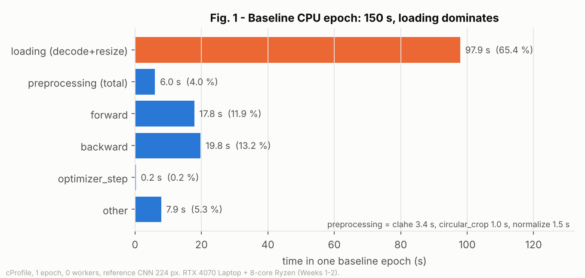
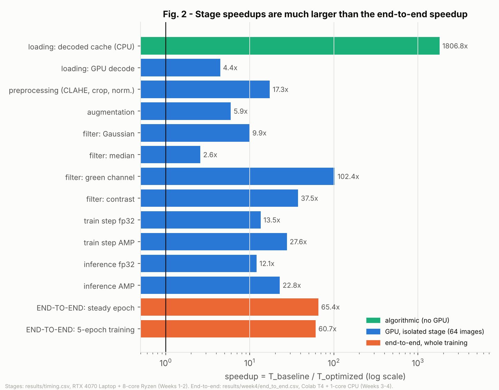
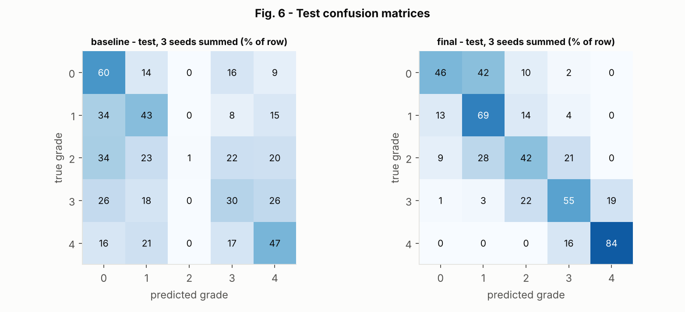
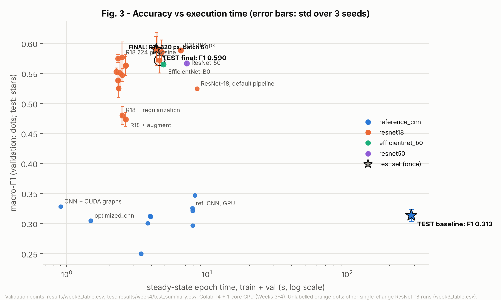
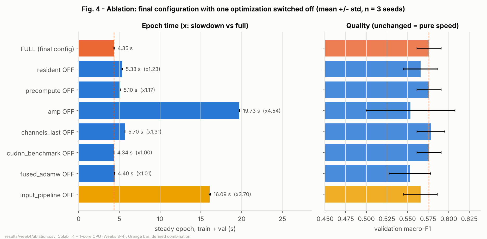
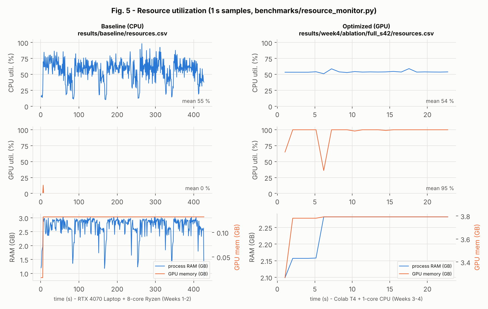

**Rule followed throughout:** every number in this report is read from a file in `results/`; the file is
named next to the number and the command that produced it is in section 11. Week-level details are in
`report/week1_report.md` (baseline, profiling), `week2_report.md` (cache, GPU image processing) and
`week3_report.md` (GPU pipeline, model redesign). This report adds the Week 4 work (GPU profiling,
ablation, test-set evaluation, same-machine end-to-end benchmark) and puts the four weeks together.

# 1. Abstract and objectives

We profiled, redesigned and GPU-accelerated a CPU reference pipeline that classifies 2,999 retinal fundus
images (FDR26) into five diabetic-retinopathy grades. The **principal bottleneck of the baseline was image
loading** (JPEG decode + resize, **65.4 %** of a profiled CPU epoch, `results/profile_stages.json`), which
bounds any speedup that leaves loading untouched at 2.89× (Amdahl). We removed it with a decoded-image
cache (CPU, 1,807× on the stage), moved preprocessing to batched GPU kernels, kept the whole dataset
resident in GPU memory, and trained with mixed precision and `channels_last`. We then redesigned the model
(ResNet-18 pretrained, cosine schedule, 320 px input, batch 64).

Main measured results:

- **End-to-end, same machine (Colab, Tesla T4 + 1-core CPU): 60.7× faster** for the full 5-epoch training
  (1,427.5 s → 23.5 s) and **65.4× per steady epoch** (285.4 s → 4.36 s), `results/week4/end_to_end.csv`.
- **Test set (used once, 3 seeds): macro-F1 0.313 ± 0.010 → 0.590 ± 0.021**, accuracy 0.357 → 0.598,
  `results/week4/test_summary.csv`. Most remaining errors are between adjacent grades.
- **Final GPU profile: the GPU is idle 0.4 % of the time** and 0.6 % of a step is data handling: the
  pipeline is now limited by the T4's convolution, batch-norm and pooling kernels, not by the input path
  (`results/week4/profile_optimized/summary.json`).
- **Ablation:** mixed precision is the most valuable single optimization of the final design (4.54×),
  then `channels_last` (1.31×), GPU-resident data (1.23×) and precompute (1.17×); cuDNN autotuning and the
  fused optimizer give nothing measurable (1.00×, 1.01×) — `results/week4/ablation.csv`.

The most important conclusion: **each optimization paid only while it targeted the current bottleneck**.
The bottleneck moved from JPEG decoding (CPU) to CPU preprocessing, then to the CPU CNN, then to GPU
preprocessing, and finally to GPU convolution compute, where it is now.

# 2. Problem and pipeline description

**Task.** 5-class DR grading (ALFEDIAM grades 0–4). FDR26 (Zenodo 20605487, CC BY 4.0): 3,000 images
listed, 2,999 present (`2T2SALA702` is missing from the archive), source resolution 4.9–10.5 Mpx JPEG.
**Splits** (`splits/splits.csv`, versioned, identical for every run): patient-level StratifiedGroupKFold,
seed 42, 70/15/15 → **2,099 / 450 / 450** images; no patient appears in two splits (checked in Week 1).
Classes are balanced inside each split.

**CPU reference pipeline** (modules A–E of the brief, diagram in `docs/pipeline.md`):

| Module | Function | Work per image |
|---|---|---|
| A Loading | `DRDataset.load` | PIL decode of a ~2,576×1,958 JPEG, bilinear resize to 224×224 |
| B Preprocessing | `preprocess_image` | CLAHE on L of LAB (clip 2, 8×8 tiles), circular crop, ImageNet normalization |
| C Filters | `filters_cpu.py` | Gaussian, median, green channel, contrast stretch (benchmarked; not on the training path) |
| D Augmentation | `augment_image` | flip + rotation ≤ 10° (off in the baseline) |
| E Training | `ReferenceCNN`, `run_epoch` | 3 conv blocks + MLP, 0.62 M parameters, 1.01 GFLOPs/image, AdamW 1e-3, 5 epochs, batch 32 |

Model selection always uses the **validation** accuracy (best epoch checkpoint); the test set is used
only by `scripts/week4_test_eval.py` (section 7.3).

# 3. Experimental environment (Table 1)

Two machines were used. **Every speedup in this report compares two runs on the same machine**; when a
table mixes machines, the machine is written next to the number. Section 7.6 re-runs the frozen final
configuration on machine L, under Windows and under WSL2 (Linux), to test portability.

| Item | Machine L (Weeks 1–2) | Machine C (Weeks 3–4) |
|---|---|---|
| CPU | AMD Ryzen 7 8845HS, 8 cores / 16 threads | Colab VM, **1 physical core / 2 threads** |
| RAM | 16 GB | 14 GB |
| GPU | RTX 4070 Laptop, 8 GB, CC 8.9, 36 SMs | **Tesla T4, 15.6 GB, CC 7.5, 40 SMs**, driver 580.82 |
| OS | Windows 11 Home | Linux 6.6 (Colab) |
| Python / PyTorch / CUDA / cuDNN | 3.14.6 / 2.14.1+cu130 / 13.0 / 9.24 | 3.13.16 / 2.11.0+cu130 / 13.0 / 9.27 |
| OpenCV / NumPy / scikit-learn | 5.0.0 / 2.5.2 / 1.9.1 | 5.0.0 / 2.1.3 / 1.6.1 |
| Source | `environment/hardware_software.md` | `results/week4/environment.json` |

| Configuration | Baseline (`configs/baseline.yaml`) | Final (`configs/optimized.yaml`) |
|---|---|---|
| Model | reference CNN (0.62 M params) | ResNet-18, ImageNet weights (11.2 M params) |
| Input | 224×224, CPU CLAHE/crop/normalize | 320×320, same preprocessing on the GPU, computed once |
| Batch / epochs / optimizer | 32 / 5 / AdamW 1e-3, no schedule | 64 / 5 / fused AdamW 1e-3, cosine schedule |
| Precision / layout | fp32 / NCHW | AMP (fp16 + GradScaler) / `channels_last` |
| Data path | DataLoader, 2 workers, decode every epoch | whole split resident in GPU memory |
| Splits | 2,099 / 450 / 450, patient-level, identical | identical |

# 4. Baseline profiling

**Methodology.** `cProfile` on one CPU epoch with `num_workers=0` so that decoding is visible in the main
process (`benchmarks/profile_baseline.py`), manual stage timers on 64 images
(`benchmarks/benchmark_stages.py`), `line_profiler` and the PyTorch Profiler on the CPU training step, and
1 s CPU/RAM sampling of the real 2-worker run (`benchmarks/resource_monitor.py`). Machine L.



| Rank | Stage | Time (s) | Share | Amdahl bound 1/(1−p) | Evidence |
|---|---|---|---|---|---|
| 1 | Loading (decode + resize) | 97.9 | **65.4 %** | 2.89× | `results/profile_stages.json` |
| 2 | Backward | 19.8 | 13.2 % | — | same |
| 3 | Forward | 17.8 | 11.9 % | (fwd+bwd+opt) 1.34× | same |
| 4 | Other (Python, collate, conversions) | 7.9 | 5.3 % | — | same |
| 5 | Preprocessing (CLAHE 3.4 s, crop 1.0 s, normalize 1.5 s) | 6.0 | 4.0 % | 1.04× | same |
| 6 | Optimizer step | 0.2 | 0.2 % | — | same |

Findings that decided the plan (details in `report/week1_report.md`): JPEG decode (39.4 s) and resize
(42.0 s) of a 5-Mpx frame to 0.05 Mpx dominate; the disk is *not* the problem (file read 1.1 % of loading
with a warm page cache); the real 2-worker baseline is loader-bound (loading alone 56.4 s per training
epoch vs 28.7 s of compute). Baseline record (machine L): **85.3 s per epoch, 428.3 s for 5 epochs,
validation accuracy 0.391, macro-F1 0.350** (`results/baseline/history.json`, `metrics_val.json`).

# 5. Redesign and optimization decisions

Each change is linked to the measurement that motivated it, applied alone first (`configs/exp_*.yaml`),
validated, and then re-profiled.

| # | Change | Motivation (measured) | Expected | Measured | Trade-off |
|---|---|---|---|---|---|
| 1 | **Decoded-image cache** (decode + resize once into a memory-mapped uint8 `.npy`) | loading = 65.4 % (sec. 4) | ≤ 2.89× end-to-end | loading 1,807× (64 img, `timing.csv`); 5-epoch CPU run 428 → 281 s (1.53×) | +0.45 GB disk at 224 px; one-time build 21 s; cache keyed by (image list, size) |
| 2 | **Batched GPU preprocessing** (OpenCV-exact LAB CLAHE, one `scatter_add_` for all tiles) | once loading is gone, CPU CLAHE is the next stage | 10–20× on the stage | 17.3× (64 img), 15.4× (128 img); **bit-exact** | custom code, needs CUDA |
| 3 | **uint8 host→device copies** instead of float32 | 4× fewer bytes per batch | ≤ 4× on the copy | 3.9× (`results/week2/h2d.csv`) | — |
| 4 | **Training on the GPU** | CPU CNN = 46 img/s after (1) | > 10× | device effect alone 25.6× per epoch (machine C) | — |
| 5 | **GPU-resident data + precompute** | after (4) the loader (1 CPU core on Colab) feeds the GPU | remove all per-epoch PCIe traffic | ablation: 1.23× and 1.17× (sec. 7.4) | +1.5 GB GPU memory (fp16 tensors of all splits) |
| 6 | **AMP + `channels_last` + cuDNN benchmark + fused AdamW** | once compute-bound, use Tensor Cores | 2× | 2.3× on the reference CNN (Week 3); AMP alone 4.54× on ResNet-18 at 320 px | numerical: fp16 activations |
| 7 | **Model redesign**: ResNet-18 pretrained, cosine LR, 320 px, batch 64 | reference CNN plateaus at val F1 ≈ 0.33 | + quality | val F1 0.33 → 0.58; test 0.31 → 0.59 | 3.6× FLOPs/image at 224 px, 2× pixels at 320 px |
| 8 | Prefetcher (side-stream copies) | overlap copies | small | no gain (3.92 → 3.97 s) | kept out of the final design |
| 9 | `torch.compile` / CUDA graphs | launch overhead | gain on small models | 1.64× on the reference CNN but +21 s cold epoch; nothing on ResNet-18 | kept off |

Redesign challenge (brief, section 6), studied one change at a time with 3 seeds (`report/week3_report.md`,
`results/week3_table.csv`): **architecture** — EfficientNet-B0, ResNet-18 and ResNet-50 (4–24 M parameters)
all reach val F1 ≈ 0.565 at 224 px, so the model is not the limit; **input representation** — 320 px
improves F1 by +0.018 (12 runs), 384 px brings nothing more for 1.5× the time; **training strategy** —
cosine is the only change that helps, augmentation and regularization hurt at a 5-epoch budget, 10–15
epochs overfit; **cost** — sections 7.1–7.4; **controlled comparison** — same splits, same budget, seeds 42–44.

# 6. Benchmarking methodology

- **Synchronization.** `GpuTimer` calls `torch.cuda.synchronize()` before and after every timed region.
  Without it an 8192² matmul "takes" 0.21 ms instead of 90.1 ms (`results/sync_demo.json`).
- **Warm-up.** `gpu_warmup()` keeps copies and matmuls in flight for 3 s before GPU benchmarks (a laptop
  GPU idles at PCIe Gen1); each end-to-end configuration has one discarded warm-up run (page cache,
  cuDNN autotuning, pretrained-weight download, cache build).
- **Timing boundaries.** *Setup* (config, loaders, cache build or GPU upload, precompute, model);
  *cold epoch* (epoch 0); *steady epoch* = mean of epochs 1–4, **train + validation**, transfers included;
  *total 5-epoch* = setup + cold + 4 × steady. One-time costs are always reported separately.
- **Repeats.** End-to-end: 3 timed repeats of the GPU run, 2 of the CPU baseline (285 s/epoch on one Colab
  core); ablation and test: 3 seeds each. We report mean ± standard deviation.
- **Profiling.** `benchmarks/profile_gpu.py` gives three views: (1) PyTorch Profiler (CPU + CUDA), 5 warm-up
  + 15 profiled steps, GPU busy time = **union** of kernel/copy intervals (not the sum, which over-counts
  overlapping streams), idle = 1 − busy / wall; (2) the same steps with a synchronization between data,
  forward, backward and optimizer, for attribution; (3) one full train epoch and one validation epoch.
  The profiler itself costs ~18 % (137.6 ms profiled vs 116.3 ms unprofiled step), so absolute times come
  from view (2)/(3) or from unprofiled runs, and the profiler is used for shares.
- **Quality.** Validation macro-F1 at the checkpointed epoch for every decision; test metrics once (7.3).

# 7. Results

## 7.1 Stage-level and end-to-end performance (Table 2)

Stage rows: 64 images, machine L, CPU vs GPU on the same machine (`results/timing.csv`). Epoch and total
rows: machine C, both configurations on the same machine (`results/week4/end_to_end.csv`).

| Pipeline stage | CPU baseline (s) | Optimized (s) | Speedup | Optimized = |
|---|---|---|---|---|
| Image loading (64 img) | 2.8078 | 0.0016 | 1,806.8× | decoded uint8 cache (CPU) |
| Preprocessing (64 img) | 0.1582 | 0.0091 | 17.3× | batched GPU kernels |
| Filtering, 4 filters (64 img) | 0.1944 | 0.0283 | 6.9× | GPU (torch); median 22.4× with the CuPy kernel at B = 128 |
| Augmentation (64 img) | 0.0306 | 0.0051 | 5.9× | GPU flip + rotation |
| Train step (64 img, reference CNN) | 0.8837 | 0.0320 | 27.6× | GPU + AMP |
| Evaluation / inference (64 img) | 0.2995 | 0.0132 | 22.8× | GPU + AMP |
| **Training per epoch** (steady, train + val) | 285.41 ± 0.74 | 4.36 ± 0.02 | **65.4×** | final configuration |
| One-time setup | 0.3 | 1.7 | 0.2× | GPU upload + precompute (cache already built) |
| **Total pipeline, 5-epoch training** | 1,427.5 | 23.5 | **60.7×** | final configuration |
| Test-set inference (450 img, img/s) | 19 (baseline model, GPU, CPU preprocessing) | 686 (final model, GPU) | — | `results/week4/test_runs.csv` |

The end-to-end rows compare *different models* (reference CNN at 224 px vs ResNet-18 at 320 px). To
separate the GPU/pipeline effect from the model effect, the same machine C gives
(`results/week3_table.csv`, steady epoch):

| Step | Run | Epoch (s) | vs CPU | Val macro-F1 |
|---|---|---|---|---|
| CPU reference (with cache) | `exp_cache_cpu` | 200.28 | 1.0× | — (2-epoch timing run) |
| + GPU, same model and data path (**device effect**) | `exp_cache_gpu` | 7.83 | 25.6× | 0.325 |
| + GPU pipeline, AMP, channels_last… (**pipeline effect**) | `optimized_cnn` | 1.48 | 135.3× | 0.305 |
| + ResNet-18, cosine, 320 px, batch 64 (**model effect**, final) | `optimized` | 4.58 | 43.7× | 0.572 ± 0.022 |

So the GPU and pipeline work make the *same* model 135× faster; the model redesign then spends 3.1× of
that speed to raise quality from F1 0.31 to 0.57–0.59. The final design is still **65× faster per epoch
than the baseline** on the same machine, and better.



**Amdahl.** The cache alone: p = 0.654, s = 1,807 → S = 1/((1 − p) + p/s) = **2.89×**, the bound itself;
measured on machine L 1.53× for 5 epochs (the 21 s build and the remaining loader overhead are inside).
All measured stage speedups together (loading 1,807×, preprocessing 17.3×, training step 27.6×, "other"
5.3 % unchanged) predict **15.5×**; the "other" 5.3 % alone caps it at 18.8×. The measured 135× for the same
model is larger because (a) it was measured on machine C, whose single CPU core makes every CPU stage
~2.3× slower than on machine L (200 s vs 86 s per CPU epoch), and (b) the "other" Python/collate overhead
disappears too once there is no DataLoader. This is the brief's point: a stage speedup says little about
the application until the remaining fractions are known.

## 7.2 Where the time goes now: GPU profile of the final configuration (A7.2–A7.4, A7.7)

`python benchmarks/profile_gpu.py --config configs/optimized.yaml` (machine C,
`results/week4/profile_optimized/`):

| Quantity | Value |
|---|---|
| Training step (batch 64, 320 px, unprofiled) | **116.3 ms**, 550 img/s |
| GPU busy (union of kernels and copies) / idle | 137.0 ms / step, **idle 0.4 %** (one gap > 50 µs every 15 steps) |
| Host→device copies per step | **none** (only 0.08 MiB device-to-device) |
| Kernels per step / mean duration | 351 / 388 µs → not launch-bound |
| Synchronized phases | data 0.8 ms (0.6 %), forward 42.9 ms (35.6 %), backward 74.1 ms (61.6 %), optimizer 2.6 ms (2.1 %) |
| Epoch | train 3.76 s (32 steps) + validation 0.31 s (8 %) = 4.07 s |

| GPU kernel category | ms / step | Share |
|---|---|---|
| Convolutions (cuDNN implicit-GEMM, fp16 Tensor Cores, NHWC) | 67.8 | 49.9 % |
| Batch norm (cuDNN NHWC fwd/bwd) | 25.3 | 18.6 % |
| Elementwise (ReLU backward, residual add, clamp) | 23.1 | 17.0 % |
| Max-pool (one layer: backward 10.2 ms, forward 6.7 ms) | 17.0 | 12.5 % |
| Fused AdamW + AMP scaler | 2.4 | 1.7 % |
| Data (randperm, `index_select` gather of the resident batch) | 0.4 | 0.3 % |

**Reading the trace (A7.4).** Between two training steps the GPU does not wait: the CPU issues kernels
faster than the GPU executes them (21.7 ms of CPU time in `forward` for 42.9 ms of GPU forward work), so
the queue never runs dry, and the only data work is a 0.4 ms gather from GPU memory. The bottleneck **moved** from the input path to the
model's own kernels. Half of the GPU time is convolution, already on Tensor Cores in fp16 and NHWC; the
other half is memory-bound layers (batch norm, elementwise, pooling) whose cost scales with activation
size (320² inputs). The single max-pool layer costing 12.5 % is a concrete lead: its NHWC backward kernel
is slow on the T4 (section 10).

**Comparison with the DataLoader path** (`--config configs/exp_resident_off.yaml`,
`results/week4/profile_exp_resident_off/`): step 140.7 ms (+21 %); each step copies 21.3 MiB of uint8
from pinned memory (1.85 ms) and spends **23.7 ms** in GPU preprocessing (CLAHE at 320 px); the GPU is
still idle only 0.4 %, so the single-core loader keeps up — what the resident + precompute design removes
is GPU *work* (preprocessing every epoch), not GPU *waiting*. The ablation confirms it (next section).

## 7.3 Classification quality on the test set (Table 3)

The configuration was frozen after the profile (GPU idle < 10 %, no input-path bottleneck left) and the
ablation. `scripts/week4_test_eval.py` then trained each model with seeds 42, 43, 44, checked on
**validation** that evaluation reproduces the checkpoint's accuracy (gap 0.0000 for all six), and
evaluated each checkpoint **once** on the 450 test images. A lock file records the single use
(`results/week4/TEST_SET_USED.json`, 2026-10-29 02:47, configs' MD5). All seeds are reported, none chosen.

| Metric (test, mean ± std over 3 seeds) | Baseline model | Final model |
|---|---|---|
| Accuracy | 0.357 ± 0.014 | **0.598 ± 0.020** |
| Macro-precision | 0.358 ± 0.123 | **0.604 ± 0.014** |
| Macro-recall | 0.363 ± 0.014 | **0.591 ± 0.023** |
| **Macro-F1** | 0.313 ± 0.010 | **0.590 ± 0.021** |
| Recall grade 0 / 1 / 2 / 3 / 4 | 0.60 / 0.43 / **0.01** / 0.30 / 0.47 | 0.46 / 0.69 / **0.42** / 0.55 / 0.84 |
| Validation macro-F1 of the same checkpoints | 0.327 | 0.562 |
| Confusion matrix | Fig. 6 (`results/week4/confusion_baseline.json`) | Fig. 6 (`confusion_final.json`) |

Macro-precision/recall/F1 are the unweighted means over the five grades of the one-vs-rest
precision, recall and F1 (scikit-learn, `average="macro"`); with balanced classes accuracy is informative,
but macro-F1 exposes the class the baseline ignores: **grade 2 is almost never predicted by the baseline
(recall 0.01)**, as already seen on validation in Week 1. The final model predicts all grades.



The final model's errors are almost all **between adjacent grades** (0↔1, 1↔2, 2↔3, 3↔4): no grade-4
image is predicted as 0, 1 or 2, while the baseline sends 16 % of grade-4 images to grade 0. The weakest
point is grade 0 (42 % predicted as grade 1). The test F1 (0.590) is slightly *above* the validation F1 of
the same checkpoints (0.562) and within the seed spread: no sign that the ~20 configurations compared on
validation in Week 3 over-fitted the validation set.



## 7.4 Ablation (A7.6, Figure 4)

`scripts/week4_ablation.py`: from `configs/optimized.yaml`, **one optimization off at a time** (plus one
clearly defined combination), 3 seeds, same GPU session, the full configuration re-run as reference.

| Variant | Switched off | Steady epoch (s) | Slowdown | Peak GPU mem (MB) | Val macro-F1 |
|---|---|---|---|---|---|
| `full` | nothing | 4.35 ± 0.03 | 1.00× | 3,357 | 0.576 ± 0.015 |
| `amp_off` | mixed precision (fp32) | 19.73 ± 0.03 | **4.54×** | 7,386 | 0.554 ± 0.054 |
| `channels_last_off` | NHWC layout | 5.70 ± 0.00 | **1.31×** | 3,354 | 0.578 ± 0.017 |
| `resident_off` | GPU-resident data (+ precompute) | 5.33 ± 0.04 | **1.23×** | 1,880 | 0.566 ± 0.020 |
| `precompute_off` | preprocessing computed once | 5.10 ± 0.01 | **1.17×** | 2,648 | 0.576 ± 0.015 |
| `fused_adamw_off` | fused optimizer | 4.40 ± 0.00 | 1.01× | 3,334 | 0.553 ± 0.025 |
| `cudnn_benchmark_off` | cuDNN autotuning | 4.34 ± 0.00 | 1.00× | 3,334 | 0.576 ± 0.015 |
| `input_pipeline_off` | resident **and** GPU preprocessing (CPU CLAHE in workers) | 16.09 ± 0.07 | **3.70×** | 1,877 | 0.566 ± 0.020 |



- **AMP is the largest single contributor (4.54×) and halves memory (7.4 → 3.4 GB).** The profile shows
  why: the step is compute-bound, and fp16 is the only way to use the T4's Tensor Cores (65 TFLOPS fp16 vs
  8 TFLOPS fp32). In Week 3, while the run was input-bound, AMP alone gave nothing (8.20 vs 7.83 s): the
  same optimization is worth 0× or 4.5× depending on where the bottleneck is.
- **`channels_last` 1.31×**: without it cuDNN inserts NCHW↔NHWC conversions around every Tensor-Core
  convolution. This gain holds on Linux only: on Windows the same flag makes the step 3.7× *slower*
  (section 7.6).
- **Resident data 1.23× and precompute 1.17×**: they remove per-epoch GPU preprocessing (23.7 ms/step in
  the profile) and the copies; with CPU preprocessing instead (`input_pipeline_off`, 3.70×) the single
  Colab core becomes the bottleneck again. Cost: +1.5 GB GPU memory, acceptable on 16 GB.
- **Fused AdamW (1.01×) and cuDNN benchmark (1.00×) give nothing measurable.** The optimizer is 2.1 % of
  a step (Amdahl: even an infinitely fast optimizer gives ≤ 1.02×). For cuDNN, the default heuristics
  already choose the same kernels for these standard ResNet shapes; autotuning only adds cold-epoch time.
  Both are kept (harmless) but we do not claim a gain.
- **Quality is unchanged by speed optimizations, and some are bit-identical.** `full`, `precompute_off`
  and `cudnn_benchmark_off` give *exactly* the same F1 per seed: precomputing in fp16 changes nothing
  numerically. `resident_off` and `input_pipeline_off` are identical to each other — GPU and CPU
  preprocessing are bit-exact (Week 2) — and differ from `full` only through the batch order
  (DataLoader shuffle vs GPU `randperm`). `amp_off` and `fused_adamw_off` change floating-point
  arithmetic, hence different, not worse, results within the seed spread (seed 42 of `amp_off`: 0.49).

## 7.5 Resource utilization (Figure 5)



The baseline uses the CPU at ~55 % on average with large dips (workers waiting on decode) and the GPU not
at all. The optimized run keeps the **GPU at 95 % utilization** on average (nvidia-smi samples of `full_s42`; the dips are the
validation pass and checkpoint saves), up to 3.9 GB of GPU memory (driver view) and 2.3 GB of host RAM;
the single CPU core only launches kernels.

## 7.6 Portability: the frozen configuration on the RTX 4070 Laptop

`configs/optimized.yaml`, unchanged, trained on machine L (Windows 11, torch 2.14.1, cuDNN 9.24) with seeds
42–44 (`results/optimized_rtx*/`), and the same with only `channels_last` off
(`configs/exp_channels_last_off.yaml`, `results/optimized_rtx_nocl*/`). Means ± std from `results/tables.md`
(section Portability):

| Machine / configuration | Steady epoch (s) | Train img/s | 5 epochs, wall (s) | Val macro-F1 |
|---|---|---|---|---|
| Colab T4, Linux, frozen config (`optimized*`) | 4.58 ± 0.12 | 484 | 26.1 ± 1.7 | 0.572 ± 0.022 |
| RTX 4070 Laptop, Windows, frozen config | **13.22 ± 0.07** | 157 | 75.4 ± 2.2 | 0.570 ± 0.032 |
| RTX 4070 Laptop, Windows, `channels_last` off | **3.83 ± 0.02** | 575 | 31.3 ± 2.3 | 0.588 ± 0.027 |

Quality reproduces (validation F1 0.570 vs 0.572, accuracy 0.581 on both), but the frozen configuration is
**2.9× slower on the RTX than on the T4**, although the RTX is the faster GPU. Re-profiling located the
cause (`benchmarks/bench_channels_last.py`: training step of the final configuration on data already on
the GPU, then one BatchNorm layer alone; same laptop, same GPU, same torch 2.14.1 and cuDNN 9.24, only the
operating system changes; `results/rtx4070/channels_last_{windows,wsl}.json`):

| Same laptop and GPU | Step, AMP + `channels_last` | Step, AMP, NCHW | `channels_last` effect | BatchNorm fp16 NHWC, cuDNN / native | Batch norm in the step |
|---|---|---|---|---|---|
| Windows 11 | 154 img/s | 570 img/s | **0.27×** | 131.4 / 16.6 ms | 341 of 406 ms GPU (84 %) |
| WSL2 Ubuntu (Linux) | 774 img/s | 576 img/s | **1.34×** | 16.6 / 16.6 ms | 16 of 82 ms GPU (20 %) |

Under Windows, cuDNN runs NHWC batch norm with generic kernels (`bn_fw_tr_1C11_singleread`,
`bn_bw_1C11_singleread`), 8× slower than PyTorch's own kernel on the same tensor; under Linux it uses the
`batchnorm_*_nhwc_semiPersist` kernels, the same ones as on the T4 (`results/week4/profile_optimized/kernels.csv`).
The tensors are NHWC in both cases, so the layout optimization itself is correct; what changes is which
library kernel the platform provides. Swapping cuDNN 9.24 for 9.27, or PyTorch 2.14.1 for 2.11.0, under
Windows did not change the kernel choice (exploratory runs, not kept in `results/`). Two consequences:
(1) **`channels_last` is platform-dependent**: ×1.31 on the T4 and ×1.34 on the RTX under Linux, ×0.27 on
the same RTX under Windows; (2) with `channels_last` off, the RTX trains 1.2× faster per steady epoch than
the T4 (3.83 vs 4.58 s), but its cold epoch is longer (11.3 vs 5.1 s, not investigated), so the 5-epoch
wall time stays above the T4's. These RTX numbers mix GPU and operating system and are not a GPU ranking.

# 8. Discussion and critical analysis

**Why did some stages benefit more than others?** Per-pixel, embarrassingly parallel work (green channel
102×, contrast stretch 37.5×, normalization) gains most; neighbourhood operations with data reuse gain
less unless written for the GPU (median: 2.6× with torch `unfold`, 22.4× with a custom CuPy kernel).
Loading gained most of all, and **not from the GPU**: decoding was redundant, so the best "kernel" was to
not run it again (1,807×). GPU JPEG decoding only reached 4.4×.

**Did overheads reduce the gains?** Yes, in two places measured in Weeks 2–3: kernel-launch overhead made
the small reference CNN launch-bound (CUDA graphs gave 1.64× on it, nothing on ResNet-18, whose 351
kernels/step average 388 µs); and transfers, until data was made resident: 21.3 MiB per step is only
1.85 ms on PCIe, but the per-step GPU preprocessing behind it was 23.7 ms.

**Did the bottleneck shift?** Five times: JPEG decode (CPU) → CPU CNN (after the cache) → CPU
preprocessing in the single-core loader (after the move to GPU) → GPU preprocessing (after GPU
preprocessing, Week 3) → **GPU convolution / batch norm / pooling compute** (now, idle 0.4 %).

**Were isolated gains reflected end-to-end?** Only partially, as Amdahl predicts (sec. 7.1): 1,807× on
loading became 1.53× end-to-end on machine L. Stage speedups of 6–1,800× combine into 65× per epoch.

**Algorithmic vs hardware gains.** On the same model and machine: device effect 25.6×; data-path redesign
(GPU preprocessing, residency, precompute) 2.3×; precision and layout (AMP, channels_last) 2.3×; the
cache is algorithmic and helps the CPU baseline as much as the GPU. The model change costs 3.1× in speed
and buys +0.28 test macro-F1.

**Classification quality.** The gain in macro-F1 comes from the **model and input redesign** (pretrained
ResNet-18 +0.20 val F1 at 224 px, cosine schedule +0.07, 320 px +0.018), not from GPU execution: the
ablation shows speed optimizations leave F1 unchanged within noise. Preprocessing changes preserved
retinal structures: GPU CLAHE is bit-exact with OpenCV, and the higher resolution helped precisely because
lesions (microaneurysms, exudates) are small. The final evaluation used data never used for selection.

**Engineering trade-offs.** More GPU memory (3.4 GB, from 0.9 GB for the CNN; 7.4 GB without AMP); a
0.45–0.92 GB disk cache; custom GPU CLAHE code (more complex, CUDA-only; the CPU path is kept and
selectable). Portability: the resident-data design needs the dataset to fit in GPU memory (it would not at
300,000 images, ~45 GB uint8: then cache + on-the-fly GPU preprocessing + prefetching is the right design).
On a GPU with more fp32 throughput relative to fp16 (or without Tensor Cores), AMP would gain less;
on a machine with many CPU cores, the CPU baseline would be ~2.3× faster and our speedup smaller
(machine L: 86 s vs 285 s per baseline epoch). **Would the same strategy pay elsewhere? Measured for one
flag (section 7.6):** `channels_last` gains 1.31× on the T4 and 1.34× on the RTX 4070 under Linux, but
costs 3.7× on the same RTX under Windows, where cuDNN has no fast NHWC batch-norm kernel. A layout
optimization is a bet on the kernels the platform provides, so it has to be re-measured on each target;
the frozen configuration is the right choice for Linux, not for Windows. The added complexity is justified by the measured gains of
AMP, channels_last, residency and precompute; it is *not* justified for fused AdamW and cuDNN autotuning,
which we keep only because they cost nothing.

# 9. Limits and threats to validity

- **Dataset.** 2,999 images (2,099 for training) from one source; balanced classes do not reflect clinical
  prevalence; the test set has 450 images (~90 per grade), so one image is 0.2 % of accuracy and the seed
  std (0.02) is of the same order as differences we discuss. Results say nothing about clinical safety or
  other cameras/hospitals; this is an educational benchmark, not a diagnostic device.
- **Two machines.** Stage tables (machine L) and end-to-end tables (machine C) are not comparable to each
  other; every speedup quoted compares runs on one machine. Machine C's single CPU core makes the CPU
  baseline weak: the same baseline epoch takes 86 s on machine L's 8-core CPU vs 285 s here, so against a
  multi-core CPU the ratio would be roughly 3.3× smaller (an estimate, not a measurement).
- **Portability.** The final configuration was re-run on one other machine only (section 7.6). There, the
  Windows and Linux numbers differ by the operating system, not the GPU; the T4 vs RTX comparison also
  differs by OS and PyTorch version, so it supports the `channels_last` conclusion, not a GPU ranking.
- **Hardware state.** Colab assigns a different VM per session; the T4 SM clock read 825 MHz in P0 after
  warm-up (power/thermal capping is common on Colab). The ablation re-ran its reference in the same session
  for this reason; Week 3 and Week 4 numbers for the same config differ by 5 % (4.58 vs 4.35 s).
- **Measurement.** The profiler adds ~18 % to a step; shares are robust, absolute profiled times are not.
  CPU baseline end-to-end: 2 repeats only (285 s/epoch); total 5-epoch times are extrapolated from 2-epoch
  runs (setup + cold + 4 × steady).
- **Numerics and seeds.** AMP and fused AdamW change floating-point results; GPU training with
  `cudnn_benchmark` can be non-deterministic (Week 3 saw ±0.02 F1 between identical configs). Three seeds
  establish directions, not statistical significance for differences below ~0.03 F1.
- **Selection.** About 20 configurations were compared on the same 450 validation images; the test result
  (above validation) does not suggest over-fitting, but n = 450 limits what it can show.
- **Baseline model trained on the GPU for its test metrics** (same config, fp32, CPU preprocessing): only
  the device changes; Week 3 showed the device does not change what the model learns beyond seed noise.

# 10. Conclusion and future work

Measuring first changed every decision: the obvious target (move the CNN to the GPU) was not the first
bottleneck; JPEG decoding was, and a CPU cache removed it. Each later optimization paid only once the
bottleneck had moved to it (AMP: 0× while input-bound, 4.5× once compute-bound). The final pipeline is
**60.7× faster end-to-end** than the baseline on the same machine, **doubles test macro-F1 (0.31 → 0.59)**,
keeps the GPU busy 99.6 % of the time, and every claim is backed by a file in `results/`.

Future work, from the remaining profile: (1) replace the stem max-pool (12.5 % of GPU time; its NHWC
backward is slow on the T4) by a strided convolution or test an NCHW pool inside the NHWC model;
(2) fuse batch-norm + ReLU + add (35 % of GPU time is memory-bound) with `torch.compile` at this
resolution, measuring the cold-epoch cost; (3) inference-only optimization (TensorRT / fp16 export);
(4) an ordinal loss, since errors are between adjacent grades; (5) the full protocol (end-to-end
benchmark, ablation) on the RTX 4070 under Linux (WSL2): section 7.6 only re-ran the final configuration
and isolated the `channels_last` effect.

# 11. Reproducibility

Code: `README.md` lists every command. Week 4 runs on Colab T4 with `notebooks/week4_colab.ipynb`:

```
python scripts/download_data.py                      # FDR26 from Zenodo, MD5-checked
python -m pytest tests -q                            # CPU/GPU equivalence, prefetcher
python benchmarks/profile_gpu.py --config configs/optimized.yaml        # sec. 7.2
python benchmarks/profile_gpu.py --config configs/exp_resident_off.yaml --no-epochs
python scripts/week4_ablation.py --seeds 42,43,44                       # sec. 7.4
python scripts/week4_test_eval.py                                       # sec. 7.3 (once)
python benchmarks/benchmark_end_to_end.py --only optimized_gpu --epochs 2 --repeats 3
python benchmarks/benchmark_end_to_end.py --only baseline_cpu --epochs 2 --cpu-repeats 2
python scripts/make_figures.py                                          # figures + results/tables.md
```

Portability (section 7.6), on the RTX 4070 laptop:

```
python src/train.py --config configs/optimized.yaml --device cuda --run optimized_rtx --seed 42             # also _s43, _s44
python src/train.py --config configs/exp_channels_last_off.yaml --device cuda --run optimized_rtx_nocl --seed 42   # also _s43, _s44
python benchmarks/bench_channels_last.py --out results/rtx4070/channels_last_windows.json  # then under WSL2: ..._wsl.json
python scripts/make_figures.py --only tables,metrics_json
```

# Appendix — Checkpoint answers (A7.9) and defense questions (8E)

**Stage speedup 30× but end-to-end 3×?** If the stage is a fraction p of the run, S = 1/((1 − p) + p/30);
S = 3 gives p ≈ 0.69: the other 31 % is untouched and bounds the result at 1/0.31 ≈ 3.2×. Our own case:
loading 1,807× with p = 0.654 → 2.89× bound, 1.53× measured including the cache build.

**Which optimization helped least relative to expectation?** cuDNN autotuning and fused AdamW (1.00×,
1.01×). The profiler explains it: the optimizer is 2.1 % of a step, and cuDNN's heuristics already pick
the implicit-GEMM fp16 NHWC kernels autotuning would pick. Earlier, the prefetcher (no gain: the uint8
copy it hides was < 2 % of a step).

**Defense, six questions.** (1) Principal bottleneck: JPEG decode + resize, 65.4 % of the baseline epoch
(cProfile, `profile_stages.json`). (2) Greatest end-to-end improvement: on the CPU, the cache; on the
GPU, mixed precision (4.54× in the ablation), after the data path was fixed. (3) Less than expected:
prefetcher, fused AdamW, cuDNN autotuning, and AMP while input-bound. (4) Quality: test macro-F1
0.313 → 0.590, from the model/input redesign, not from the speed optimizations (ablation). (5) Remaining
bottleneck: GPU compute — convolutions 50 %, batch norm 19 %, elementwise 17 %, max-pool 12.5 %; GPU idle
0.4 %. (6) Reproducible elsewhere: correctness (bit-exact preprocessing, test metrics within seed noise),
the bottleneck sequence and the Amdahl reasoning; hardware-dependent: absolute times, the 65× ratio
(1-core Colab CPU), the size of the AMP gain (T4 Tensor Cores), memory headroom for resident data; and
platform-dependent, measured: `channels_last` (×1.31 on the T4, ×1.34 on the RTX under Linux, ×0.27 on the
same RTX under Windows, section 7.6). Classification quality reproduced on the RTX (val F1 0.570 vs 0.572).
