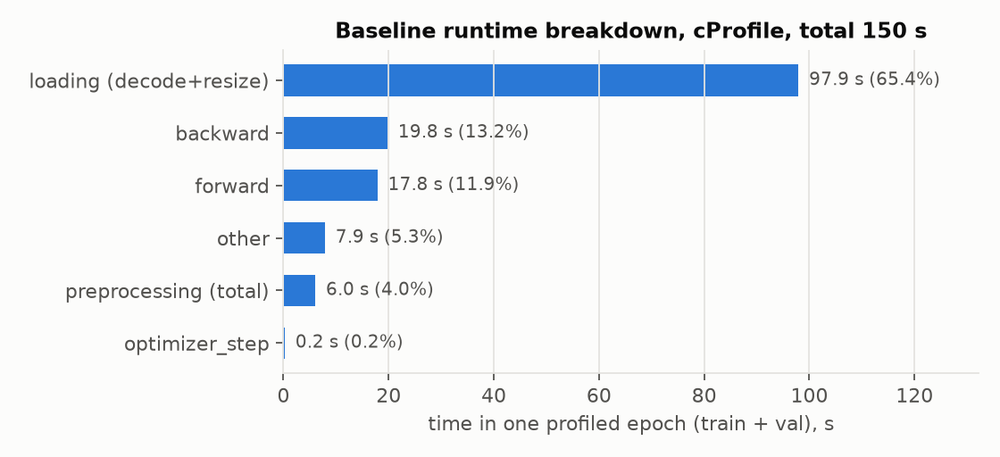
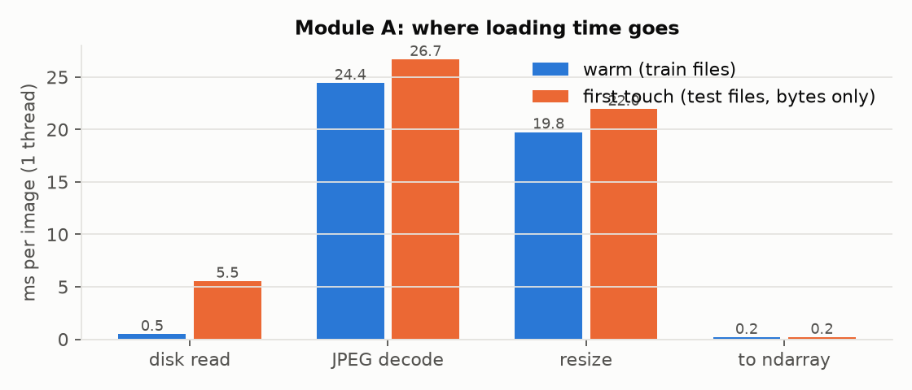
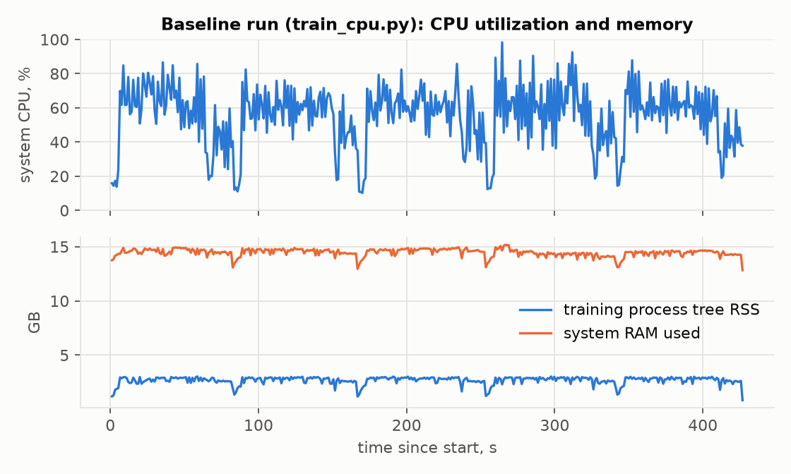

# Week 1 — Baseline execution and bottleneck identification

**Project:** GPU acceleration of a diabetic-retinopathy (DR) classification pipeline (ENSIAS, 2026)
**Team:** Zeynab Belkasmi, Ouiam Ouatat, Amina Ouaayi, Meryem Ramdi
**Machine for every number below:** RTX 4070 Laptop GPU + Ryzen 7 8845HS, see [Table 1](#2-experimental-environment-table-1)
**Rule followed:** every number is read from a file in `results/`; the producing command is given next to it.

---

## 0. Summary

| | Finding | Evidence |
|---|---|---|
| Baseline quality | 5-epoch reference CNN: **val accuracy 0.391, macro-F1 0.350**; DR2 is almost never predicted (recall 0.011). Test set not used. | `results/baseline/history.json`, `results/baseline/metrics_val.json` |
| Baseline cost | **428.3 s** wall time for 5 epochs; **85.3 s/epoch** (69.3 s train + 16.0 s validation); 1.5 s one-time setup | `results/baseline/history.json` |
| Principal bottleneck | **Image loading (decode + resize) = 65.4 %** of a profiled epoch; JPEG decode 39.4 s + resize 42.0 s + a hidden full-resolution copy 9.3 s | `results/profile_stages.json`, `results/profile_baseline.txt` |
| The real (2-worker) run is loader-bound | pure loading of one training epoch through the baseline DataLoader takes 56.4 s, compute alone 28.7 s; the measured train epoch is 69.3 s | `results/week2/cache.json`, `results/timing.csv` |
| Disk is not the problem | with a warm OS page cache the file read is **1.1 %** of loading time; first-touch read 10 % | `results/week1/loading_breakdown.json` |
| Amdahl bound | removing loading entirely bounds the end-to-end speedup at **2.89x** on the profiled epoch; loading + preprocessing at 3.28x; everything except training compute at 3.95x | computed from `results/profile_stages.json` |

Optimization priorities for Week 2 (justified in section 7): **(1)** remove the repeated decode/resize (decoded-image cache), **(2)** move training compute to the GPU (Week 3), **(3)** batch the preprocessing on the GPU, mainly to keep it off the critical path once (1) and (2) are done.

---

## 1. Initial analysis of the reference code (modules A–E)

The starter code (`gpua-student.zip`) was merged into the team repository. Our pre-downloaded dataset and shared split are used as they are (section 3). This table maps each module of the brief to the functions that implement it, with the static diagnostic made before profiling. Section 6 confirms or refutes each point with measurements.

| Module | Implemented by | What it does | Static diagnostic (hypothesis to check by profiling) |
|---|---|---|---|
| **A – Loading** | `src/data_loader.py`: `DRDataset.load`, `DRDataset.__getitem__`, `make_loaders`, `get_splits` | PIL `Image.open` → `convert("RGB")` → `resize((224,224), BILINEAR)` → `np.asarray`; then `astype(float32)/255`. DataLoader, batch 32, 2 workers, `drop_last` on train | Every epoch decodes **every** JPEG again (5 epochs × 2,549 train+val images = 12,745 decodes of 2,549 distinct files). Sources are 4.9–10.5 Mpx, the target is 0.05 Mpx: decode and downscale work is ~100× the output size. `convert("RGB")` on an RGB image is a full copy. No cache, no pinned memory, no `persistent_workers`. |
| **B – Preprocessing** | `src/preprocess_cpu.py`: `preprocess_image` → `apply_gamma` (off, γ=1), `apply_clahe`, `circular_crop`, `normalize`; injected by `CpuTransform` in each worker | CLAHE on the L channel of LAB (clip 2.0, 8×8 tiles), zero outside the fundus disc, ImageNet mean/std, HWC→CHW | One image at a time. float→uint8→LAB→uint8→float round trip inside CLAHE (6 temporaries). `circular_crop` **re-draws the same constant mask for every image** and uses boolean fancy indexing. `normalize` allocates 2 full-size temporaries. Images of aspect 1.32 and 1.24 are squashed to a square before the circular crop (section 6.3). |
| **C – Filters** | `src/filters_cpu.py`: `gaussian_blur`, `median_filter`, `green_channel`, `contrast_stretch` | 5×5 Gaussian (σ=1), 5×5 median on uint8, green channel, 1–99 % percentile stretch | **Not on the training path** (`preprocess_image` never calls them). They are timed as a standalone stage, as the brief asks. `contrast_stretch` uses `np.percentile`, a full O(n log n) partition per image for two order statistics. |
| **D – Augmentation** | `preprocess_cpu.augment_image`, called by `CpuTransform(augment=True)` for the train split only | random horizontal flip + rotation in [−10°, 10°], reflect border | **Disabled in the baseline** (`preprocess.augment` absent from `configs/baseline.yaml`). It is timed as a standalone stage. Its RNG is seeded per worker from `torch.initial_seed()`, so it is reproducible. |
| **E – Training / evaluation** | `src/model.py: ReferenceCNN`; `src/train.py: run_epoch, main`; `src/evaluate.py` | 3 conv blocks (32-64-128 ch, 3×3, ReLU, max-pool) + adaptive-avg-pool 4×4 + MLP 2048→256→5 (dropout 0.3); AdamW lr 1e-3, 5 epochs, cross-entropy; best-val checkpoint | ~1.0 GFLOP forward per 224² image (conv2 and conv3 ≈ 0.46 GFLOP each) → ~3 GFLOP per training image. CPU-only conv in fp32. Loss/accuracy are accumulated on the device (no per-batch sync, A2.2). Model selection uses validation only. |

Code-level fixes made during the analysis (needed for correct measurements, no behaviour change of the baseline):

- `src/utils.py: GpuTimer` now calls `torch.cuda.synchronize()` before and after the timed region (A2.1). Without it, an 8192² matmul "takes" **0.21 ms instead of 90.1 ms** (a 440× error, 5,356 "TFLOPS" against the real 12.2), see `results/sync_demo.json` (`benchmarks/sync_demo.py`).
- `set_seed(seed, cudnn_benchmark=False)` (A1.5). The baseline and every accuracy run keep cuDNN autotuning **off**, so the convolution algorithm (and floating-point summation order) is fixed and run-to-run differences come from the seed only. Throughput benchmarks may switch it on: shapes are fixed (224², `drop_last=True`), so autotuning happens once in the discarded warm-up.
- `src/train.py: run_epoch`: the line that would force one device→host sync per batch is documented (`loss.item()` vs `loss.detach()` accumulation, A2.2).
- `src/evaluate.py --split val`: the same metric report as the test evaluation, computed on validation, so the baseline's classification quality can be verified in Week 1 **without using the test set** (`results/baseline/metrics_val.json`).

---

## 2. Experimental environment (Table 1)

From `results/environment.json` (`python scripts/record_env.py`) and `environment/hardware_software.md`.

| Item | Value |
|---|---|
| CPU | AMD Ryzen 7 8845HS, 8 cores / 16 threads |
| RAM | 16 GB (15.3 GB visible); **~14.5 GB in use** during the baseline (other applications open) |
| GPU | NVIDIA GeForce RTX 4070 Laptop, 8 GB, CC 8.9, 36 SMs, PCIe Gen4 x8 (idles at Gen1) |
| Driver / CUDA / cuDNN | 592.82 / 13.0 / 9.24 |
| OS | Windows 11 Home 10.0.26200, AC power, "Balanced" plan |
| Python / PyTorch / torchvision | 3.14.6 / 2.14.1+cu130 / 0.29.1 |
| NumPy / OpenCV / Pillow / scikit-learn | 2.5.2 / 5.0.0 / 12.3.0 / 1.9.1 |
| Threads | torch CPU 8, OpenCV 16 |
| Dataset storage | NVMe SSD; 2,999 JPEGs, 1.73 GB |
| Configuration | 224×224 RGB, batch 32, 2 DataLoader workers, 5 epochs, AdamW 1e-3, seed 42, cuDNN benchmark off |

---

## 3. Data verification (A1.1, A1.4)

The team downloaded and standardized FDR26 once (`scripts/download_data.py`, MD5-checked). The split is the team's shared, versioned `splits/splits.csv` (`scripts/make_splits.py`: `StratifiedGroupKFold`, groups = patient, 20 folds → 14/3/3 = 70/15/15 %, seed 42). The teacher's `split_by_patient` (random patient shuffle, not stratified) is **not** used; `configs/*.yaml` add `data.split_csv` and `get_splits()` reads it, so every script and every teammate trains on the same images. This is a deliberate, documented deviation from the starter code: it keeps patient-level separation and adds class stratification.

| Check | Result | Source |
|---|---|---|
| Images present | 2,999 of the 3,000 metadata rows; `2T2SALA702` is missing from the Zenodo archive and is dropped with a warning | `src/data_loader.py: load_metadata` |
| Split sizes | train 2,099 / val 450 / test 450 images; 1,341 / 289 / 288 patients | `splits/splits.csv` |
| Patient leakage | **0** patients in more than one split (asserted at generation and in `tests/test_data_loader.py`) | |
| Class balance (DR0–DR4) | total 504 / 701 / 583 / 632 / 579; train 354/491/408/441/405; val 75/105/87/96/87; test 75/105/88/95/87 | |

The dataset is only **approximately** balanced: DR1 has 1.39× as many images as DR0. Stratification keeps each split at the same proportions. This is why macro-F1 is reported next to accuracy.

Why patient-level splitting matters: 855 of the 1,918 patients have several images, which share camera, illumination and pigmentation. Most of them also share the grade; 407 patients have images of different grades. With an image-level split the network could recognize the patient instead of the lesions, and validation/test accuracy would be inflated by an amount we cannot measure. That makes every comparison in the project meaningless.

Image geometry, scanned over all 2,999 headers: 1,782 images are 2576×1958, 940 are 1960×1958, 273 are 3600×2910 and 4 are 1956×1934. Every image is resized to 224×224 regardless of aspect ratio (1.32, 1.00, 1.24). For about 68 % of the images the fundus disc becomes an ellipse before `circular_crop` applies a circle. This is an input-representation question for the Week 3 redesign challenge, not a performance one, and we leave the baseline unchanged.

---

## 4. Baseline execution record (A1.7, A1.8)

```bash
python src/train_cpu.py                                   # configs/baseline.yaml on CPU, --monitor on
python src/evaluate.py --config configs/baseline.yaml --run baseline --device cpu --split val
```

### 4.1 Classification metrics (validation split, best checkpoint = epoch 4)

| Metric | Value |
|---|---|
| Accuracy | **0.3911** (identical to the value stored in the checkpoint: the reload and evaluation path is consistent) |
| Macro-precision | 0.4201 |
| Macro-recall | 0.3846 |
| Macro-F1 | **0.3499** |

| Class | Precision | Recall | F1 | Support |
|---|---|---|---|---|
| DR0 | 0.403 | 0.413 | 0.408 | 75 |
| DR1 | 0.500 | 0.505 | 0.502 | 105 |
| DR2 | 0.500 | **0.011** | 0.022 | 87 |
| DR3 | 0.316 | 0.510 | 0.390 | 96 |
| DR4 | 0.382 | 0.483 | 0.426 | 87 |

Confusion matrix (rows = true DR0..DR4, columns = predicted):

```
[[31,  9, 0, 31,  4],
 [19, 53, 1, 13, 19],
 [17, 15, 1, 38, 16],
 [ 9,  9, 0, 49, 29],
 [ 1, 20, 0, 24, 42]]
```

| Epoch | train loss | train acc | val acc | val macro-F1 | train time (s) | val time (s) |
|---|---|---|---|---|---|---|
| 0 | 1.5832 | 0.232 | 0.289 | 0.185 | 65.3 | 17.3 |
| 1 | 1.5544 | 0.269 | 0.282 | 0.234 | 68.7 | 15.5 |
| 2 | 1.5292 | 0.295 | 0.309 | 0.241 | 70.3 | 16.3 |
| 3 | 1.4991 | 0.342 | 0.364 | 0.309 | 72.3 | 15.6 |
| 4 | 1.4798 | 0.345 | **0.391** | **0.350** | 69.9 | 15.5 |

Interpretation: the model is far from converged: training loss is still falling and train accuracy (0.345) is below validation accuracy, so the model underfits at a 5-epoch budget. The intermediate grade DR2 is absorbed by its neighbours (38 of 87 predicted DR3). These numbers are the **reference** that every optimization must preserve (same split, same budget). Improving them is the Week 3 redesign challenge. The test set has not been touched; `evaluate.py` runs once on test per final model (A7.8).

### 4.2 Runtime: one-time vs repeated costs

| Cost | Value | Kind |
|---|---|---|
| Setup (config, split, model, optimizer) | 1.49 s | one-time |
| Cold epoch (epoch 0, includes worker spawn) | 82.6 s | one-time + repeated |
| Steady epoch (mean of epochs 1–4) | 86.0 s | repeated |
| Training per epoch (mean ± std, 5 epochs) | **69.3 ± 2.3 s** (30 img/s) | repeated |
| Validation per epoch | **16.0 ± 0.7 s** | repeated |
| Total (5 epochs) | **428.3 s** wall; 346.5 s training + 80.2 s validation | |

There is no measurable cold-start penalty on the CPU: the cold epoch is *faster* than the steady state. Training time drifts upward from 65.3 s to 72.3 s, which is consistent with the laptop's sustained-load clock reduction. This is noted as a threat to validity: CPU repeats must be interleaved or the laptop allowed to cool. The truly one-time costs appear in Week 2 (cache build, CUDA context, LUT construction), which is why this table must be redone for the optimized pipeline.

---

## 5. Profiling methodology (A2)

| Tool | What it measures here | Command | Output |
|---|---|---|---|
| `cProfile` | one full epoch (train + val, 2,530 images) **in-process** with `num_workers=0`, so decoding and preprocessing are visible (with workers they run in children that cProfile cannot see) | `python benchmarks/profile_baseline.py` | `results/profile_baseline.txt`, `results/profile_stages.json` |
| manual stage timers | each stage separately on the same 64 training images, warm-up + 3–5 repeats, mean ± std | `python benchmarks/benchmark_stages.py --n 64` | `results/timing.csv` |
| I/O breakdown | Module A split into disk read / JPEG decode / resize / array, 200 warm and 200 first-touch files, process read bytes | `python benchmarks/profile_io.py` | `results/week1/loading_breakdown.json` |
| `line_profiler` | time per source line of `DRDataset.load`, `preprocess_image`, `apply_clahe`, `circular_crop`, `normalize` | `python benchmarks/profile_line.py` | `results/week1/line_profile.txt` |
| PyTorch Profiler (CPU) | ATen-operator time and memory of the training step (batch 32, 2 warm-up + 6 profiled steps) | same script | `results/week1/torch_profiler_cpu_ops.txt`, `..._summary.json` |
| Resource monitor | system CPU %, system RAM, process-tree RSS, GPU utilization at 1 Hz during the full baseline | `python src/train_cpu.py` | `results/baseline/resources.csv` |
| Nsight Systems | not informative for a CPU-only baseline (no CUDA activity); used on the GPU code in Week 2 | | `results/week2/nsys_stats.txt` |

Timing boundaries: wall clock (`perf_counter`), synchronized on CUDA (section 1). Profiling overhead: cProfile inflates Python-heavy code (its epoch is 149.6 s with 0 workers versus 85 s for the real run), so cProfile is used for **fractions**, and absolute stage costs come from the stage benchmark.

---

## 6. Results

### 6.1 Time per stage (Figure 1)



One epoch under cProfile (`results/profile_stages.json`, 149.6 s, 0 workers):

| Stage | Time (s) | Share | Main contributors (`results/profile_baseline.txt`) |
|---|---|---|---|
| Loading (decode + resize) | **97.91** | **65.4 %** | PIL `resize` 41.98 s, JPEG `decode` 39.44 s, `ImagingCore.copy` 9.30 s, file open/other 7.2 s |
| Backward | 19.75 | 13.2 % | autograd engine |
| Forward | 17.84 | 11.9 % | `conv2d` 10.32 s, max-pool 5.85 s |
| Preprocessing | 6.03 | 4.0 % | CLAHE 3.38 s, normalize 1.52 s, circular crop 1.01 s |
| Optimizer step | 0.23 | 0.2 % | AdamW |
| Other | 7.87 | 5.3 % | collate, `astype`, Python overhead |

Stage benchmark on the same 64 images (`results/timing.csv`), the CPU column of Table 2:

| Pipeline stage | CPU time for 64 images (s, mean ± std) | per image | Note |
|---|---|---|---|
| Image loading | 2.808 ± 0.008 | 43.9 ms | decode + resize |
| Preprocessing | 0.158 ± 0.002 | 2.47 ms | CLAHE + crop + normalize |
| Filtering (Gaussian / median / green / contrast) | 0.016 / 0.061 / 0.006 / 0.111 = **0.194** | 3.04 ms | standalone, not on the training path |
| Augmentation | 0.031 ± 0.002 | 0.48 ms | standalone, disabled in the baseline |
| Training step (forward + backward + AdamW), 64 images | 0.884 ± 0.008 | 13.8 ms (72 img/s) | one batch of 64 |
| Inference, 64 images | 0.299 ± 0.005 | 4.7 ms (214 img/s) | |
| Training per epoch (full run) | 69.3 ± 2.3 | | `history.json` |
| Evaluation (validation) per epoch | 16.0 ± 0.7 | | `history.json` |
| Total pipeline (5 epochs) | 428.3 | | `history.json` |

### 6.2 Module A: loading, disk I/O and memory



`results/week1/loading_breakdown.json` (single thread, 200 images each):

| | disk read | JPEG decode | resize | to ndarray | total | read throughput |
|---|---|---|---|---|---|---|
| warm (train files, in page cache) | 0.48 ms (1.1 %) | 24.43 ms (54.5 %) | 19.76 ms (44.1 %) | 0.18 ms | **44.8 ms** (22.3 img/s) | 1,354 MB/s |
| first touch (test files, bytes only) | 5.54 ms (10.2 %) | 26.68 ms | 21.95 ms | 0.19 ms | 54.4 ms (18.4 img/s) | 151 MB/s |

- **The loading stage is CPU-bound, not I/O-bound.** Even on first touch, reading is 10 % of loading. Decode and resize are 89–99 %. A faster disk would gain at most 10 %.
- **Redundant work:** the baseline decodes each training image 5 times (once per epoch) and each validation image 5 times. The output is identical every time, because augmentation is off and would be applied after loading anyway.
- **Intermediate memory:** a decoded frame is 15.1 MB (2576×1958×3), and up to 31.4 MB for the 3600×2910 images, versus 0.15 MB for the 224×224 output. `convert("RGB")` duplicates that frame (`ImagingCore.copy`, 9.3 s per epoch). The PIL resize from 5–10 Mpx to 0.05 Mpx with an antialiasing filter costs as much as the decode itself.
- Bytes read per epoch: the 2,099 training files are 1,171 MB (`results/week2/cache.json`), i.e. ~1.4 GB per epoch for train+val and ~7 GB over the 5-epoch run, for 1.73 GB of distinct data.

### 6.3 Module B: preprocessing, line by line (A2.7)

`results/week1/line_profile.txt`, 64 images (line_profiler overhead included):

| Function | Line | Share of function | What it shows |
|---|---|---|---|
| `apply_clahe` (2.6 ms/img) | `cv2.cvtColor(u8, RGB2LAB)` | **57.5 %** | the colour conversion, not CLAHE, dominates |
| | `cv2.cvtColor(merge, LAB2RGB)` | 20.0 % | |
| | `createCLAHE(...).apply(l)` | 9.2 % | the actual equalization is cheap; the CLAHE object is also rebuilt per image |
| | float↔uint8 conversions | 12.0 % | `(img*255).astype(uint8)`, `astype(float32)/255` |
| `circular_crop` (0.4 ms/img) | `out[mask == 0] = 0` | **86.8 %** | boolean fancy indexing; the mask itself (constant) is rebuilt every call |
| `normalize` (0.6 ms/img) | `(img - MEAN) / STD` | 100 % | two full-size float temporaries |
| `DRDataset.load` | `convert("RGB").resize(...)` | **96.0 %** | confirms 6.2 at line level |

This is what cProfile could not show (A2.7): cProfile reports `apply_clahe` as one 3.38 s block. line_profiler shows that **77 % of CLAHE is LAB colour conversion**. A GPU CLAHE that only accelerates the histogram equalization would therefore miss most of the cost. The Week 2 design accelerates the conversion explicitly.

### 6.4 Module E: training, operator level (PyTorch Profiler)

`results/week1/torch_profiler_cpu_summary.json` (batch 32, 8 threads, compute only, data already in memory):

| Part of the step | ms per step | Share |
|---|---|---|
| forward | 200.0 | 41.5 % |
| backward | 279.1 | 58.0 % |
| optimizer (AdamW) | 2.4 | 0.5 % |
| **compute-only throughput** | | **66.5 img/s** |

Top self-time operators per step: `convolution_backward` 187.3 ms, `mkldnn_convolution` 118.8 ms, `max_pool2d_with_indices` 57.9 ms, `threshold_backward` (ReLU grad) 38.9 ms, `max_pool2d_backward` 28.3 ms, `fill_` 21.8 ms, `clamp_min_` (ReLU) 19.9 ms. The convolutions (forward + backward) take 64 % of the step, while pooling and ReLU, which are memory-bound elementwise work at 224² × 32 channels, take 30 %. The optimizer is negligible. This argues for GPU execution, which provides both FLOPs and bandwidth, and later for mixed precision and `channels_last`. Tuning the optimizer would not help.

### 6.5 Resource utilization (A2.8)



`results/baseline/resources.csv` (389 samples at 1 Hz):

| Metric | Mean | Median | Max |
|---|---|---|---|
| System CPU utilization (16 logical CPUs) | **55.3 %** | 57.7 % | 98.3 % |
| Training process tree RSS (main + 2 workers) | 2.68 GB | 2.82 GB | 3.03 GB |
| System RAM used (of 15.3 GB) | 14.46 GB | 14.52 GB | 15.17 GB |
| GPU utilization | 0.0 % | 0 % | 13 % (desktop) |

**The CPU is not saturated.** On average ~9 of 16 logical CPUs are busy. The main process runs the CNN on 8 torch threads, while only 2 worker processes decode JPEGs. With 2 workers at ~37 img/s (`results/week2/cache.json`: 56.4 s per training epoch of pure loading), loading alone needs 56 s per epoch and compute alone 2,080 / 72 ≈ 28.7 s. The two run concurrently and compete for the same 8 physical cores, so the measured 69.3 s per epoch is set by the loader. This is the "GPU-less" version of the classic input-pipeline bottleneck: a faster model would not shorten the epoch until loading is fixed. Memory is not a constraint for the pipeline (2.7 GB), but the machine is close to its RAM limit because of other applications. This is a validity risk (paging) that we control in later runs by closing them.

---

## 7. Bottleneck ranking and Amdahl bounds (A2.6)

Fractions *p* from `results/profile_stages.json`. The bound is S_max = 1 / (1 − p) if the stage became free; *S(s)* = 1 / ((1 − p) + p/s) for a finite stage speedup *s*.

| Rank | Bottleneck | p | Amdahl bound S_max | S if the stage gets 10× faster | Evidence | Week 2 action |
|---|---|---|---|---|---|---|
| **1** | Repeated JPEG decode + resize (Module A) | **0.654** | **2.89×** | 2.43× | cProfile 97.9 s; decode 24.4 + resize 19.8 ms/img; read 1 %; DataLoader epoch 56.4 s | **decode once:** uint8 cache (memmap) |
| **2** | Training compute, forward + backward (Module E) | 0.251 | 1.34× | 1.29× | 37.6 s; conv 64 % of step; 66.5 img/s | GPU, AMP, channels_last (Week 3) |
| **3** | Preprocessing, CLAHE + crop + normalize (Module B) | 0.040 | 1.04× | 1.04× | 6.0 s; LAB conversion 77 % of CLAHE | batched GPU preprocessing (Week 2) |
| 4 | "Other": collate, float conversion, Python | 0.053 | 1.06× | — | 7.9 s | shrinks with uint8 batches + GPU conversion |
| 5 | Optimizer step | 0.002 | 1.00× | — | 0.23 s | none |
| — | Filters (C), augmentation (D) | 0 in the baseline | — | — | standalone: 3.0 and 0.48 ms/img | GPU versions, measured as stages |

Combined bounds: loading + preprocessing p = 0.695 → **3.28×**. Everything except training compute p = 0.747 → 3.95×. To go beyond ~4× end-to-end, training must also move to the GPU, which is exactly the order of the brief (Week 2 then Week 3).

**Why the order matters:** preprocessing is only 4 % of the baseline, so a perfect GPU CLAHE alone gives at most 1.04×. It becomes worth accelerating only after loading (rank 1) is gone. Then preprocessing would rise to ~12 % of what remains, and to roughly a third once training also runs on the GPU. We therefore still implement it in Week 2, as the brief requires. The Week 2 report states its end-to-end value with this bound, not with the kernel speedup.

---

## 8. Optimization hypotheses handed to Week 2

| # | Hypothesis (from the evidence above) | Expected effect | Validation |
|---|---|---|---|
| H1 | Decoding/resizing the same images every epoch is redundant; a decoded uint8 cache, built once, removes ~65 % of the epoch | loading per epoch from ~56 s to < 1 s; end-to-end bounded by 2.89× | cache bit-exact with `DRDataset.load`; first-run build cost and disk size reported |
| H2 | CLAHE cost is in LAB conversion → a GPU version must accelerate the colour conversion, not only the histogram | 10× or more per batch | bit-exactness vs OpenCV, or a stated tolerance |
| H3 | Per-pixel steps (crop, normalize) are memory-bound → batching + fusing them into one kernel and caching the constant mask removes redundant allocations | > 50× vs per-image NumPy | max abs error < 1e-5 |
| H4 | Copying uint8 instead of float32 batches cuts host→device bytes by 4× | ~4× lower transfer time | measured H2D, pinned vs pageable |
| H5 | Neighbourhood filters (median) need a custom kernel to beat OpenCV's SIMD | library vs custom comparison | bit-exactness |

## 9. Checkpoint answers

**A1.10.** *Once:* split loading, model/optimizer construction (and, after Week 2, cache build, CUDA context, LUTs). *Every epoch:* decode, resize, preprocessing, forward/backward/step, validation. *Bytes per batch at 224²:* uint8 32×3×224×224 = **4.82 MB**; float32 = **19.27 MB**. *`drop_last=True`:* the last incomplete training batch (2,099 = 65×32 + 19) is dropped, so **2,080 images per epoch**. Throughput must be computed with 2,080, not 2,099. The batch shape is constant, which also matters for cuDNN autotuning.

**A2.3 / A2.10, prediction vs measurement.** We predicted *forward + backward* first (≈ 50 %), loading second (≈ 30 %), CLAHE third. The measurement inverted the first two: loading is 65 %, compute 25 %. We underestimated two things: the sources are 5–10 Mpx (decode and antialiased downscale are ~100× the output size), and the reference CNN is small (~1 GFLOP per image). CLAHE was over-estimated: 2.3 % of the epoch.

**Why `num_workers=0` for cProfile but not for benchmarks:** with workers, decode and preprocessing run in other processes and cProfile only sees the main process waiting on a queue. For a benchmark of the real pipeline, workers are part of the system being measured; with 0 workers, loading can never overlap compute, which over-states its share.

**A stage taking 18 % of the time:** the largest possible end-to-end speedup is 1 / (1 − 0.18) = **1.22×**.

---

## 10. Threats to validity

- **Thermal / power:** training time drifts +11 % from epoch 0 to 3. The laptop was on AC, "Balanced" plan. Comparisons should interleave configurations or repeat runs (Week 4).
- **RAM pressure:** 14.5 of 15.3 GB used by the system during the baseline, with paging possible. Re-measure with other applications closed.
- **OS page cache:** Windows cannot drop it without admin tools; the "first touch" files approximate a cold read.
- **Profiler overhead:** cProfile slows Python-level code (149.6 s vs 85 s per epoch). It is used for fractions only.
- **Single run of the baseline:** one 5-epoch run, one seed. The accuracy variance between seeds is not yet known (Week 3/4).

## 11. Reproduce

```bash
python scripts/record_env.py
python src/train_cpu.py
python src/evaluate.py --config configs/baseline.yaml --run baseline --device cpu --split val
python benchmarks/profile_baseline.py
python benchmarks/benchmark_stages.py --n 64
python benchmarks/profile_io.py
python benchmarks/profile_line.py
python benchmarks/sync_demo.py
python scripts/make_week_figures.py
```
