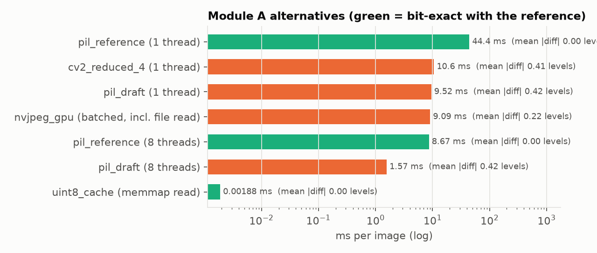
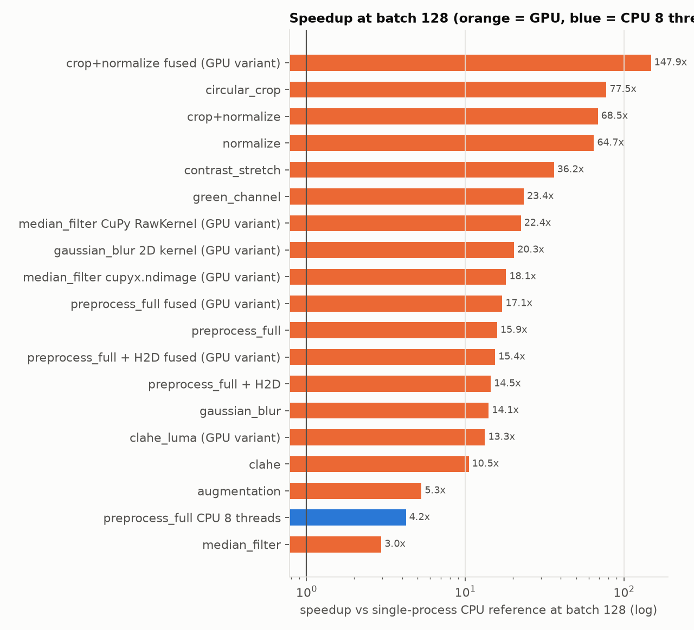
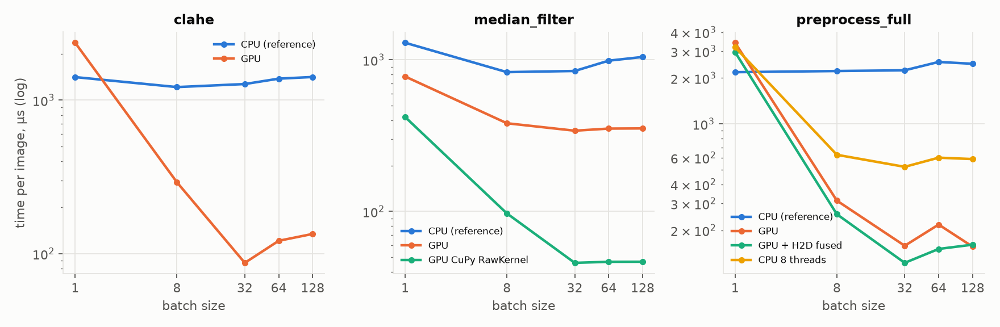

# Week 2 — Algorithmic redesign and GPU acceleration of image processing

**Project:** GPU acceleration of a DR classification pipeline (ENSIAS, 2026). Same machine and software as Week 1 (Table 1: RTX 4070 Laptop 8 GB, Ryzen 7 8845HS, PyTorch 2.14.1 + CUDA 13.0, CuPy 14.2, OpenCV 5.0).
**Rule followed:** every number comes from a file in `results/`; commands are in section 11.

---

## 0. Summary

| Change | Stage result | Correctness | Evidence |
|---|---|---|---|
| **Decoded-image cache** (decode + resize once, memory-mapped uint8) | loading of one training epoch: **56.4 s → 0.34 s** (164×); per image 44.4 ms → 1.9 µs | **bit-exact**; a full 5-epoch training run gives *identical* losses and metrics | `results/week2/cache.json`, `loading.csv`, `results/exp_cache/` |
| ↳ end to end (one change only, CPU training) | **428.3 s → 280.8 s (1.53×)** including the 21 s one-time build; steady epoch 86.0 → 51.6 s (1.67×) | val acc 0.3911 / macro-F1 0.3499 unchanged | `results/exp_cache/history.json` |
| **Batched GPU preprocessing** (CLAHE + crop + normalize, B = 128, incl. H2D copy) | **317.5 ms → 20.6 ms (15.4×)**; 4.2× for an 8-thread CPU pool | **bit-exact** with the CPU (unfused); ≤ 2.4e-7 when fused | `results/week2/sweep.csv`, `equivalence.csv` |
| GPU CLAHE (OpenCV-exact LAB) | 181.1 → 17.2 ms (10.5×); **14.6×** at B = 32 | **bit-exact** | |
| GPU filters | Gaussian 20.3×, median **22.4×** (custom CuPy kernel; torch `unfold` only 3.0×), green 23.4×, contrast stretch 36.2× | median bit-exact (3 implementations), others ≤ 3.6e-7 | |
| GPU augmentation (flip folded into one `grid_sample`) | 74.7 → 14.1 ms (5.3×) | max 1.7e-5 vs `cv2.warpAffine` with the same draws | |
| uint8 instead of float32 host→device copies | 5.86 → 1.51 ms per 128-image batch (3.9×) | — | `results/week2/h2d.csv` |

Main lesson: the GPU kernels give 10–150× on isolated stages, but the cache, a CPU-side algorithmic change, is what moves the end-to-end time this week (Amdahl, section 7). With loading gone, the pipeline is now **compute-bound on the CPU CNN** (46 img/s), and that is the Week 3 target.

---

## 1. Starting point and what can be gained (Week 1)

| Stage | Share of the profiled baseline epoch (p) | Amdahl bound 1/(1−p) |
|---|---|---|
| Loading (decode + resize) | 0.654 | 2.89× |
| Forward + backward + optimizer | 0.253 | 1.34× |
| Preprocessing (CLAHE, crop, normalize) | 0.040 | 1.04× |
| Filters, augmentation | not on the baseline path | — |

Because of this ranking, Week 2 does two things. It redesigns loading, the only stage that can move the end-to-end time now. It also builds the batched GPU image-processing stages, which the brief requires, so that they are ready (and validated) when training moves to the GPU in Week 3 and preprocessing becomes a large share of what remains.

## 2. Design proposal: hypotheses linked to measured bottlenecks (A3.6)

| # | Optimization | Measured bottleneck (file, number) | Hypothesis | Expected gain | Cost / trade-off | Validation |
|---|---|---|---|---|---|---|
| 1 | Decoded uint8 cache, built once, memory-mapped | `profile_stages.json`: loading p = 0.654; `loading_breakdown.json`: decode 24.4 + resize 19.8 ms/img, read 1 % | the 5 decodes per image per run are redundant; reading 150 KB from the page cache is ~1000× cheaper | loading → ~0; end to end ≤ 2.89× (profiled), less in the real overlapped run | 316 MB of disk (27 % of the JPEGs); one-time build; stale-cache risk | cache[i] == `DRDataset.load(i)` (test); identical training run |
| 2 | Batched GPU CLAHE with LUT colour conversion | `line_profile.txt`: RGB↔LAB = 77 % of CLAHE; CLAHE 72 % of preprocessing | a GPU CLAHE must accelerate the colour conversion; a 256³ LUT makes it one gather and exact | ≥ 10× on a batch | 96 MiB of VRAM; complexity | bit-exactness vs `apply_clahe` |
| 3 | Crop + normalize fused into one kernel, constants cached | `line_profile.txt`: boolean indexing 87 % of crop; mask rebuilt per image | memory-bound ops: one read + one write per pixel instead of three; no per-image constant | > 50× vs NumPy, ~2.5× vs unfused GPU | ~1 ulp rounding difference | max error < 1e-5 |
| 4 | uint8 host→device copies, conversion on the device | 4 B/value float32 batches (19.3 MB per 32) | PCIe time ∝ bytes | ~4× on the copy | none | identical values (true division) |
| 5 | Custom median kernel (A4.11) | `timing.csv`: median 1.0 ms/img on CPU; neighbourhood op | `unfold` materializes k² copies; a register-resident window avoids that traffic | library vs custom comparison | CuPy dependency | bit-exact |
| 6 | Augmentation as one affine `grid_sample` per batch | `timing.csv`: 0.48 ms/img (off in the baseline) | per-image `warpAffine` → one batched kernel with the flip folded into the matrix | > 5× | different interpolation rounding | same draws → max error < 1e-2 |

**Order of experiments:** (1) first, because it is the only change with a large end-to-end bound, and it is measured alone (`configs/exp_cache.yaml`). Then (2)–(6) as stage benchmarks on identical images. Their end-to-end effect is measured in Week 3, when the GPU training loop exists.
**Risks:** launch overhead on small batches; PCIe and clock power management of a laptop GPU; VRAM taken by constants; a cache that is invalid after a change of image list or size.

---

## 3. Software architecture redesign

### 3.1 Data path

```
 [once]   build_cache(items, size, dir)  -- 8 threads, PIL decode+resize, identical to DRDataset.load
          -> data/cache/u8_224x224_<N>_<md5(paths,size)>.npy   (N,224,224,3) uint8, written to *.tmp then os.replace
 [epoch]  DataLoader worker: np.memmap row (page cache)  ->  3x224x224 uint8 (raw) or CPU transform (baseline)
                       |  B x 3 x 224 x 224 uint8 (4.8 MB / 32 images), pinned
          ====== PCIe: 1 copy per batch, 1 byte per value ======
 [GPU]    to_float_bchw  ->  [augment_gpu]  ->  clahe_gpu  ->  crop_normalize_fused  ->  CNN (Week 3)
```

Implementation choices, each motivated by a measurement:

- **Cache key = MD5 of (paths, size).** A changed split or resolution can never reuse a stale file (A3.7). The write is atomic (temporary file + `os.replace`; the memmap is closed first, because Windows cannot rename a mapped file).
- **Worker pickling (Windows `spawn`).** Pickling an `np.memmap` copies its whole content into every worker (316 MB × 2). `DRDataset.__getstate__` sends only the file name, and each worker re-maps it, so all workers share one copy in the OS page cache.
- **Shared split.** `get_splits()` reads `splits/splits.csv`, so the cache, the benchmarks and training all see the same 2,099 / 450 / 450 images.

### 3.2 GPU module design (`src/preprocess_gpu.py`, `src/filters_gpu.py`)

| Principle | How | Evidence it matters |
|---|---|---|
| **Whole batch, no Python loop over images or tiles** | every function takes (N,3,H,W); CLAHE builds all N·64 tile histograms in one `scatter_add_` | kernel count is independent of N (68 for CLAHE at any batch); per-image cost drops 27× from B = 1 to B = 32 |
| **Constants built once per (shape, device)** | `_CONST` cache: circle mask, mean/std, CLAHE index maps and weights, LAB LUTs, Gaussian taps, the 1/255 divisor | 99.4 MiB of constants, built in the warm-up; no per-call allocation for them |
| **The pipeline owns its tensor → in-place ops** | `to_float_bchw` returns a fresh tensor; crop/normalize run in place or fused; the caller's input is cloned if it was already a float CUDA tensor | fused crop+normalize: 1 kernel and 74 MiB peak instead of 3 kernels and 222 MiB (`gpu_resources.csv`) |
| **uint8 over PCIe, convert on the device** | `x.to(device, non_blocking=True)` first, then `copy_` + true division | 3.9× less copy time (section 5.4) |
| **No hidden host synchronization** | no `bincount` (it reads `max(ids)` back to the host), no host-built scalar `.to(device)` in the hot path | host time per CLAHE call 19.0 → 1.78 ms (Nsight, section 5.6) |
| **Exactness where the reference is integer** | uint8 quantization by truncation like `astype(np.uint8)`; integer histograms; float32 interpolation in OpenCV's evaluation order; round-half-even like `cvRound` | bit-exact CLAHE, median, crop, normalize, full pipeline |

### 3.3 CLAHE redesign (the core algorithm)

OpenCV's `apply_clahe` = uint8 RGB → LAB → CLAHE(L, clip 2.0, 8×8 tiles) → RGB. The GPU version reproduces every step for the whole batch:

1. **Colour conversion as a lookup.** OpenCV's 8-bit LAB conversions are fixed-point code with internal tables, so re-deriving them in float gives ±1-level differences. All 256³ = 16.7 M colours are converted once with OpenCV itself (two tables of 48 MiB, ~0.5 s at first use), and each pixel then costs one gather. The trade is **96 MiB of VRAM for exactness and speed**. An analytic float conversion would avoid the memory and lose exactness.
2. **All tile histograms at once.** bin id = (image·64 + tile)·256 + L, built with one `scatter_add_` into N·64·256 int64 bins. If H or W is not a multiple of 8, OpenCV's reflect-101 padding is reproduced with precomputed row/column index maps; this case is tested at 230×250.
3. **Clip and redistribute, vectorized.** limit = max(⌊clip·area/256⌋, 1); the excess is spread as ⌊excess/256⌋ per bin, and the residual follows OpenCV's stride rule (bins i ≡ 0 mod ⌊256/residual⌋, i/step < residual), written as a boolean mask instead of a loop.
4. **Per-tile LUT** = round(cdf · (255/area)) in float32 with round-half-even.
5. **Bilinear blend** of the 4 neighbouring tile LUTs with precomputed tile indices and float32 weights (`x/tile − 0.5`), evaluated in the same order as OpenCV. That is four `gather`s.

A lighter `mode="luma"` (the hint in the starter code: CLAHE on the channel mean, RGB rescaled by (eq+1)/(lum+1)) is kept for comparison. It takes 21 % less time at B = 128 but is not equivalent (max 47 levels, section 6).

### 3.4 Filters and augmentation

| Function | GPU algorithm | Alternative measured |
|---|---|---|
| Gaussian 5×5, σ = 1 | depthwise `conv2d`, reflect padding (= OpenCV reflect-101), taps from `cv2.getGaussianKernel` | separable 2-pass (default) vs direct 2D kernel |
| Median 5×5 | uint8 quantization (as the CPU), replicate padding by index, `unfold` view + `median` | **(A4.11)** custom CuPy `RawKernel`: one thread per pixel, 25 values in registers, partial selection sort; `cupyx.scipy.ndimage.median_filter` (library) |
| Green channel | a view `t[:, 1:2]` (no copy) | — |
| Contrast stretch | exact 1 % / 99 % percentiles via two `topk` (k ≈ 1,507 out of 150,528 values per image) + linear interpolation like `np.percentile` | `torch.quantile` refuses inputs > 2²⁴ elements (a 128-image batch has 19.3 M) and sorts the whole row |
| Augmentation | flip + rotation as one (N,2,3) affine matrix per image: `cv2.getRotationMatrix2D` converted to normalized coordinates, including the half-pixel centre offset; the flip negates the source x row; `grid_sample(reflection)` = `BORDER_REFLECT` | — |

CuPy runs on **torch's current stream** (`cupy.cuda.Stream.from_external`) and shares memory through DLPack, so there are no copies and no ordering hazards.

---

## 4. Benchmarking methodology

- **Same inputs:** the first 128 training images (real fundus images, not noise), decoded once. CPU and GPU process identical arrays.
- **CPU reference:** the per-image functions of `preprocess_cpu` / `filters_cpu` in one process (OpenCV uses its 16-thread pool internally), 1 warm-up + 3 repeats. A **CPU thread-pool row** (8 threads over images) gives the best-effort multi-core number, so the GPU is not compared only against a single core.
- **GPU:** 3 warm-ups + 10 repeats per point; `GpuTimer` synchronizes before and after; mean ± std; batch sizes 1, 8, 32, 64, 128.
- **GPU power state (a finding).** The first H2D measurements gave **3.3 GB/s** for uint8 against 13 GB/s for float32, which is physically implausible. `nvidia-smi` showed the laptop GPU idling in P8 at 210 MHz with the PCIe link trained down to Gen1, so short benchmarks were measuring the ramp-up. `src/utils.py: gpu_warmup()` now keeps copies and matmuls in flight for 5 s first and records the state: P8/210 MHz → P0/2,145 MHz, Gen4 x8 (`results/week2/summary.json`). The invalid first numbers are kept in `results/week2/h2d_before_warmup_fix.csv`. Every number below is post-warm-up.
- **Correctness** is measured on the same 128 real images (section 6) and enforced by 25 unit tests.
- **End to end:** one change at a time, same config otherwise (`configs/exp_cache.yaml`).

---

## 5. Results

### 5.1 Loading (Module A)



`results/week2/loading.csv`, 256 training images, compared with the reference pixels:

| Variant | ms / image | Speedup | Max \|diff\| (levels) | Mean \|diff\| | Bit-exact pixels |
|---|---|---|---|---|---|
| PIL decode + BILINEAR resize, 1 thread (**reference**) | 44.35 | 1.0× | 0 | 0 | 100 % |
| same, 8 threads | 8.67 | 5.1× | 0 | 0 | 100 % |
| PIL draft (JPEG DCT downscale) + resize, 1 thread | 9.52 | 4.7× | 65 | 0.42 | 71.7 % |
| PIL draft, 8 threads | 1.57 | 28× | 65 | 0.42 | 71.7 % |
| OpenCV `IMREAD_REDUCED_COLOR_4` + INTER_AREA | 10.60 | 4.2× | 51 | 0.41 | 74.3 % |
| nvJPEG on GPU (batched) + antialiased resize, incl. file read | 9.09 | 4.9× | 183 | 0.22 | 94.4 % |
| **uint8 cache (memmap read)** | **0.0019** | **~23,500×** | **0** | **0** | **100 %** |

Cache life cycle on the full training split (`results/week2/cache.json`):

| | Value |
|---|---|
| Build (first run, 8 threads, 2,099 images) | **17.4 s** (once); later runs reopen it in 1.8 ms |
| Size on disk | **316 MB** for train (vs 1,171 MB of JPEG: 27 %); 451 MB for all 2,999 images |
| One epoch of pure loading, decode, 0 / 2 workers (baseline) | 88.2 s / **56.4 s** |
| One epoch of pure loading, cache, 0 / 2 workers | **0.34 s** / 4.49 s |

Decision: **adopt the cache.** It is the only option that is both exact and essentially free per epoch. The faster decoders (draft, reduced, nvJPEG) change the input by up to 65–183 levels on some pixels, so adopting one of them would be a separate experiment on the model's input. They remain useful for a dataset too big to cache. nvJPEG was disappointing (4.9×). Our implementation reads files on one Python thread and resizes each 5–10 Mpx frame as float32, so the GPU decode is not the limit. A DALI-style pipeline would be needed.

**End-to-end validation of the cache** (only `data.cache_dir` changed; CPU training, same seed, `results/exp_cache/`):

| | Baseline | + cache | Speedup |
|---|---|---|---|
| Setup (one-time; includes building train + val caches) | 1.5 s | 22.9 s | — |
| Training per epoch (mean) | 69.3 s | **45.1 s** | 1.54× |
| Validation per epoch (mean) | 16.0 s | **6.4 s** | 2.50× |
| Steady epoch | 86.0 s | **51.6 s** | **1.67×** |
| Total 5 epochs (wall) | 428.3 s | **280.8 s** | **1.53×** |
| Val accuracy / macro-F1 / confusion matrix | 0.3911 / 0.3499 | **identical, every epoch, bit for bit** | |

The cache pays for itself within the first epoch (21.4 s build vs 34.4 s saved per epoch).

### 5.2 Stage-level CPU vs GPU (A4)



`results/week2/sweep.csv`, batch 128 (and 32), GPU input already on the device unless "+ H2D":

| Stage | CPU 128 imgs (ms) | GPU 128 imgs (ms) | Speedup @128 | Speedup @32 |
|---|---|---|---|---|
| CLAHE (exact) | 181.1 ± 5.2 | 17.21 ± 0.06 | **10.5×** | **14.6×** |
| CLAHE luma variant (not exact) | ″ | 13.60 ± 0.18 | 13.3× | 11.0× |
| Circular crop | 71.8 ± 0.6 | 0.93 ± 0.41 | 77.5× | 62.5× |
| Normalize | 93.4 ± 1.3 | 1.45 ± 0.04 | 64.7× | 53.5× |
| Crop + normalize | 148.9 ± 2.0 | 2.18 ± 0.04 | 68.5× | 65.3× |
| Crop + normalize **fused** | ″ | **1.01 ± 0.02** | **147.9×** | 125.8× |
| Full preprocessing (CLAHE + crop + normalize) | 317.5 ± 9.2 | 19.97 ± 0.07 | 15.9× | 14.2× |
| ↳ fused | ″ | 18.55 ± 0.05 | 17.1× | 24.6× |
| ↳ **+ H2D copy of the uint8 batch** | ″ | 21.93 ± 0.06 | 14.5× | 16.0× |
| ↳ **fused + H2D** (the version for training) | ″ | **20.57 ± 0.09** | **15.4×** | **18.4×** |
| ↳ CPU, 8-thread pool | 75.1 ± 0.6 | — | 4.2× | 4.3× |
| Gaussian blur, separable | 36.4 ± 0.8 | 2.59 ± 0.06 | 14.1× | 6.6× |
| Gaussian blur, 2D kernel | ″ | 1.79 ± 0.01 | 20.3× | 8.2× |
| Median, torch `unfold` | 133.6 ± 5.3 | 45.13 ± 0.13 | **3.0×** | 2.5× |
| Median, **CuPy RawKernel** | ″ | **5.96 ± 0.03** | **22.4×** | 18.4× |
| Median, `cupyx.ndimage` | ″ | 7.39 ± 0.04 | 18.1× | 17.2× |
| Green channel | 6.6 ± 0.7 | 0.28 ± 0.01 | 23.4× | 19.2× |
| Contrast stretch | 300.6 ± 31.1 | 8.31 ± 0.19 | 36.2× | 57.8× |
| Augmentation (flip + rotation) | 74.7 ± 10.4 | 14.09 ± 0.61 | 5.3× | 2.0× |

### 5.3 Batch size and the CPU/GPU crossover (A4.13)



Time per image (µs), `results/week2/sweep.csv`:

| Batch | 1 | 8 | 32 | 64 | 128 |
|---|---|---|---|---|---|
| CLAHE CPU | 1,413 | 1,216 | 1,273 | 1,380 | 1,415 |
| CLAHE GPU | **2,365** | 292 | **87** | 121 | 134 |
| Median CPU | 1,296 | 829 | 844 | 987 | 1,044 |
| Median GPU, torch | 776 | 381 | 341 | 352 | 353 |
| Median GPU, CuPy kernel | 419 | 97 | **46** | 47 | 47 |
| Full preprocessing CPU | 2,185 | 2,223 | 2,247 | 2,551 | 2,480 |
| Full preprocessing GPU (fused) | 2,024 | 282 | **91** | 133 | 145 |

- **The GPU loses at B = 1 for CLAHE** (2.4 ms vs 1.4 ms) and for augmentation and the Gaussian blur. A CLAHE call is 68 kernels (`gpu_resources.csv`). At one 224² image each kernel has almost no work, so the call costs launch and dispatch latency (~35 µs per kernel including PyTorch's Python dispatch). **The crossover lies between B = 1 and B = 8 for every stage.** At B = 8 the GPU is already 4.2× faster on CLAHE.
- **The best per-image cost is at B = 32, not 128.** For CLAHE, cost per image rises from 87 µs (B = 32) to 134 µs (B = 128). Our explanation, a hypothesis to confirm with Nsight Compute in Week 3: the int64 index tensors of CLAHE are 12.8 MB each at B = 32 and fit in the GPU's 32 MB L2 cache, while at B = 128 (51 MB each) every gather goes to DRAM. The median kernel, which keeps its window in registers, has no such knee. Practical consequence: GPU preprocessing should be called on batches of 32. That is also the training batch size, and a larger loader batch can be processed in chunks.
- The per-image CPU cost also grows with the batch (e.g. crop 445 → 561 µs). This is not algorithmic: every output is a fresh 0.6 MB array, and with 14.5 GB of 15.3 GB of RAM in use the allocator and page faults grow with the live set. It is one more argument for the GPU design's buffer and constant reuse.

### 5.4 Host-to-device transfers (A4.14)

`results/week2/h2d.csv` (after warm-up, PCIe Gen4 x8):

| Batch | dtype | pageable (ms) | pinned (ms) | pinned GB/s |
|---|---|---|---|---|
| 32 | uint8 (4.8 MB) | 0.49 | **0.43** | 11.1 |
| 32 | float32 (19.3 MB) | 1.71 | 1.51 | 12.7 |
| 128 | uint8 (19.3 MB) | 1.73 | **1.51** | 12.7 |
| 128 | float32 (77.1 MB) | 6.70 ± 1.10 | 5.86 | 13.2 |

- Copying uint8 and converting on the GPU makes the copy **3.9× cheaper** at the same bandwidth. Pinned memory is 12–15 % faster and, above all, stable (std 0.05 vs 1.10 ms). It is also the condition for an asynchronous `non_blocking` copy (Week 3).
- **Share of GPU preprocessing spent on the copy:** with H2D, B = 128 costs 21.93 ms against 19.97 ms device-resident, a difference of 1.96 ms ≈ 9 %. Of that, 1.51 ms is the uint8 copy and the rest is the uint8→float32 conversion. With float32 copies it would be 5.86 ms ≈ 22 % of the stage.
- Per epoch: 2,080 training images × 150,528 B = **313 MB** cross PCIe as uint8 instead of 1.25 GB as float32 (A5.10 preview).

### 5.5 GPU memory, allocations and kernel launches (B = 128)

`results/week2/gpu_resources.csv`; input batch = 73.5 MiB float32:

| Stage | Peak extra memory (MiB) | Allocations / call | CUDA kernels / call |
|---|---|---|---|
| Crop + normalize, unfused | 222 | 3 | 3 |
| **Crop + normalize, fused** | **74** | **1** | **1** |
| CLAHE | 405 | 60 | 68 |
| Full preprocessing (fused) | 480 | 62 | 69 |
| Median, torch `unfold` | **664** (25 uint8 copies of the batch) | 10 | 12 |
| Median, CuPy RawKernel | **111** | 4 | 5 |
| Gaussian blur | 151 | 5 | 5 |
| Contrast stretch | 149 | 32 | 51 |
| Augmentation | 123 | 36 | 45 |
| **Constants (all, resident)** | **99.4** (of which LAB LUTs 96.0) | once | — |

No `cudaMalloc` is issued in steady state, because PyTorch's caching allocator recycles blocks. The "allocations" are allocator requests served from cache. Reducing them still matters: fewer requests means less peak memory (the fused op needs 3× less) and fewer kernels. The highest peak is under 0.7 GiB, so batch 128 preprocessing fits comfortably in 8 GB alongside the CNN.

### 5.6 Re-profiling the GPU implementation: the bottleneck moved twice

Profiling the first GPU version (PyTorch Profiler and Nsight Systems, `benchmarks/nsys_preprocess.py` with NVTX ranges) found two problems that are invisible in a kernel-time benchmark:

| Iteration | Observation (tool, file) | Cause | Fix | Effect |
|---|---|---|---|---|
| v1 | `aten::bincount` = **75 % of host time**, 16 ms per call (`torch_profiler_gpu_preprocess_v1.txt`) | CUDA `bincount` reads `max(ids)` back to the host: one blocking device→host sync per CLAHE call | `scatter_add_` of a stride-0 view of ones (no allocation of N ones) | histogram 0.84 → 0.42 ms at B = 128, 0.23 → 0.15 ms at B = 32 (`ab_clahe_histogram.csv`); host no longer blocked |
| v2 | 66 host→device copies for 24 batches; host time inside the `clahe` NVTX range: **median 19.0 ms** (`nsys_stats_v2.txt`) | the LUT scale `torch.tensor(255)/area` was built on the host and copied on every call, a synchronous pageable copy | scalar cached on the device | 43 copies (24 batches + one-time constants), host time per CLAHE call **1.78 ms** (`nsys_stats.txt`) |
| v3 (final) | `gatherMedian` (torch `median`) = **61 % of GPU kernel time** in the Nsight workload | sort-based median over a 25-wide axis of a k²-sized tensor | the CuPy RawKernel (section 5.2) | 45.1 → 5.96 ms |

Kernel count per CLAHE went from 76 to 68 and allocations from 72 to 60 (`gpu_resources_v1.csv` vs `gpu_resources.csv`) because the LAB index is now one `(u8.long()·[65536,256,1]).sum(1)` instead of eight shift/or/cast kernels. GPU time per CLAHE at B = 32 went from 3.14 ms (v1) to 2.79 ms. At B = 128 the total did not improve (16.7 → 17.2 ms, within thermal variation). There the cost is memory traffic, not the histogram, which is an unsuccessful hypothesis we keep in the record. The value of removing the syncs is that the host can now queue the next batch while the GPU works. That is the precondition for the Week 3 prefetcher.

**Remaining GPU bottlenecks** (final `torch_profiler_gpu_preprocess.txt`): elementwise `add`/`mul`/`copy_` kernels (mostly int64 index arithmetic and dtype casts) are 69 % of GPU time in the preprocessing pipeline, and the four `gather`s take 7 %. The next step would be one fused CUDA kernel for the LAB-index + CLAHE lookup + LAB→RGB chain, or int32 indexing. `affine_grid` in augmentation launches an sgemm (5 % of the Nsight workload) only to build the sampling grid.

---

## 6. Numerical equivalence and tolerances (A4.12)

`results/week2/equivalence.csv`: 128 real training images, GPU vs CPU reference:

| Stage | Max \|diff\| | Mean \|diff\| | Bit-exact values | Within 1/255 | Tolerance adopted |
|---|---|---|---|---|---|
| CLAHE (LAB, LUT) | **0** | 0 | **100 %** | 100 % | exact |
| CLAHE luma variant | 0.184 (47 levels) | 0.019 | 0.7 % | 8.7 % | not equivalent; luminance correlation 0.9986 |
| Circular crop / normalize / crop+normalize | **0** | 0 | **100 %** | 100 % | exact |
| Crop+normalize fused | 2.4e-7 | 2.6e-8 | 55 % | 100 % | ≤ 1e-6 (1–2 ulp) |
| Full preprocessing (unfused / fused) | **0** / 2.4e-7 | 0 / 3.2e-8 | **100 %** / 50 % | 100 % | exact / ≤ 1e-6 |
| Gaussian (separable / 2D) | 2.4e-7 / 3.6e-7 | ~1e-8 | 66 % / 56 % | 100 % | ≤ 1e-6 |
| Median: torch, CuPy kernel, cupyx | **0** | 0 | **100 %** | 100 % | exact |
| Green channel | **0** | 0 | **100 %** | 100 % | exact |
| Contrast stretch | 3.6e-8 | 6.2e-9 | 40 % | 100 % | ≤ 1e-6 |
| Augmentation (same flips/angles) | 1.7e-5 | 8.5e-8 | 54 % | 100 % | ≤ 1e-2 (OpenCV quantizes bilinear weights to 1/32 px) |

**Do we agree with the starter tolerances?** Partly. The test `test_clahe_equivalence_within_tolerance` accepts any CLAHE whose luminance correlates > 0.95 with OpenCV's. The luma variant passes it (0.9986) while differing by up to 47 grey levels, which shows the test is too weak to protect the model's input. Because our implementation is exact, the tests now demand **bit-exactness** wherever the CPU reference is integer-based (CLAHE at two image sizes including the padding path, median ×3, full pipeline with CLAHE, circle mask at 6 sizes, the 1/255 division). They keep a floating-point tolerance only where the arithmetic order necessarily differs: convolution 1e-6 and fused affine ops, contrast percentiles 1e-3 as given, and rotation 1e-2 because of OpenCV's fixed-point weights. Result: **`python -m pytest tests -v` → 42 passed, 1 failed** (`test_prefetcher_yields_same_batches_on_device`, the Week 3 `CudaPrefetcher` not yet written; `results/logs/pytest.log`).

One subtle finding: `x.div_(255.0)` on CUDA is **not** a division. PyTorch lowers division by a Python scalar to multiplication by the rounded reciprocal, which is 1 ulp off for some inputs (max 6e-8 on our images). Dividing by a cached 0-dim device tensor restores IEEE division and bit-exactness with NumPy's `u8 / 255.0` (`div255_`, `test_div255_is_true_division`).

---

## 7. Discussion

**Largest and smallest speedups (A4.15).**
- *Largest:* fused crop + normalize, **148×**. The NumPy reference is the worst case: it rebuilds a constant mask, indexes with a boolean array and allocates two temporaries per image. The GPU version is one memory-bound kernel at ~150 GB/s effective (2 × 73.5 MiB in 1.0 ms). Most of this "speedup" is algorithmic redesign (no rebuilt constant, no temporaries, fusion), not GPU hardware.
- *Smallest:* the torch `unfold` median, **3.0×**. It materializes 25 copies of the batch (664 MiB) and calls a generic sort-based median. The algorithm, not the device, limits it. The custom register-resident kernel on the same GPU reaches 22.4×, which is the clearest case in the project where a custom kernel beats both the library-composition approach and the dedicated library (`cupyx`, 18.1×). We would ship the RawKernel: it is exact, fastest and needs 6× less memory. The cost is a CuPy dependency, with the torch version kept as a fallback.
- *Augmentation, 5.3×:* `grid_sample` is cheap, but building 45 small kernels for the (N,2,3) matrices and the `affine_grid` sgemm dominates at small batch (2.0× at B = 32).
- *CLAHE, 10–15×:* bounded by memory traffic of the int64 index tensors (section 5.3), not by arithmetic.
- *Separable Gaussian, a refuted hypothesis:* 2 × 5 taps should beat 25 taps. But at k = 5 both versions are memory-bound, and the separable one makes two passes plus an intermediate, so the direct 2D depthwise convolution is **1.45× faster**. We keep separable as the default only for larger kernels, and the measurement says to switch for k = 5.

**Is the stage speedup reflected end to end? (Amdahl)** No, not yet, and this is expected. On the profiled baseline, preprocessing is p = 0.040, so even an infinite preprocessing speedup bounds the end-to-end gain at 1.04×; at the measured 15.4×, S = 1/(0.960 + 0.040/15.4) = **1.038×**. The cache, by contrast, attacked p = 0.654 and delivered **1.53× end to end** (1.67× steady state). That is below the 2.89× bound for two measured reasons. In the real 2-worker run, loading already partly overlapped with compute, so its effective share was smaller than in the 0-worker profile. And the epoch is now limited by the CPU CNN: 45.1 s per training epoch = 46 img/s, against 72 img/s for the compute-only training step. The difference is the CPU preprocessing and collate in workers competing with the 8 torch threads for 8 cores (58 % mean CPU utilization, `results/exp_cache/resources.csv`).

**Did the bottleneck move?** Yes. Before Week 2 it was decode + resize, and after the cache it is **CNN compute on the CPU**. Inside the GPU image processing, it moved from host syncs (bincount, scalar copy) to the median kernel and then to int64 memory traffic in CLAHE. Once training runs on the GPU in Week 3 (benchmark_stages: training step 13.5× faster on GPU, 27.6× with AMP, `results/timing.csv`), the CPU preprocessing at 2.47 ms/img (≈ 5 s per epoch in workers) will become a dominant stage. That is when the 15× GPU preprocessing turns into an end-to-end gain.

**Engineering trade-offs.**

| Optimization | Extra resources | Complexity / portability | Worth it? |
|---|---|---|---|
| uint8 cache | +316 MB disk (train), +68 MB (val); 17–21 s once | low; invalid if the resize changes (hashed name) | **yes**: 1.53× end to end, exact |
| LUT-based exact CLAHE | +96 MiB VRAM; 0.5 s first call | medium; depends on OpenCV for table generation | yes for validation work; `luma` is a cheaper option if exactness is relaxed and its effect on accuracy is shown (Week 3) |
| CuPy median kernel | CuPy dependency, CUDA only | ~40 lines of CUDA C | yes: 7.5× over the torch version |
| Fusion, in-place, constants | none | low | yes |
| Faster JPEG decoders | none / GPU | changes the pixels | not adopted |

Would the same strategy work on another machine? The cache gain grows with slower CPUs and larger source images, and holds on any machine with ~0.5 GB of free disk. The GPU stage speedups depend on the GPU's L2 size (the B = 32 knee), PCIe generation and laptop power management (P-states), so they must be re-measured on the school's server.

---

## 8. Checkpoint answers

**A3.7.** *When does a cache lose?* When it cannot fit in RAM or fast disk. At 300,000 images it would be 45 GB at 224² and must be read from disk every epoch, at which point its read cost approaches the decode it replaces. It also loses when augmentation must run before the resize, because the cache would have to store full-resolution images, and when resolution changes per experiment, because each size needs its own cache. *Why must the file name depend on the image list and size?* Otherwise a changed split or resolution would silently reuse stale pixels and break the "same data" rule without any error. *CPU or GPU optimization?* It is a CPU/I/O optimization: it removes decode work. It pays off **even more** with GPU preprocessing, because the GPU path needs exactly what the cache provides, raw uint8 batches, and a fast GPU makes the loader the bottleneck sooner.

**A4.16.** *Why can a GPU kernel be slower than OpenCV on one 224² image?* One CLAHE call is 68 kernel launches with ~35 µs of fixed launch and dispatch cost each, plus a synchronization. One image gives each kernel 50 k elements, too little to fill 36 SMs, while OpenCV runs the same work from L2 in a tight SIMD loop (1.4 ms). Measured crossover: between B = 1 and 8. *What does the `unfold` median's k² memory limit?* The batch size: at k = 5 it needs 664 MiB of extra memory for 128 images, and at k = 7 or B = 512 it would compete with the CNN for 8 GB. It also limits speed, because bandwidth is spent copying windows. *Does a non-exact CLAHE matter for classification?* Our default is exact, so it does not. For the `luma` variant (max 47 levels), the test is a controlled Week 3 run: same split, seed and budget, CLAHE mode as the only change, compare val macro-F1 against the seed-to-seed variance.

## 9. Limitations and threats to validity

- Laptop GPU power management changes timings (P-states, PCIe Gen1↔4). It is mitigated by `gpu_warmup`, but clocks still vary (2,145 → 1,980 MHz during the sweep). Thermal state also matters: CPU training times drift +11 % across a run.
- RAM was ~94 % used by the system during the runs, which inflates CPU per-image costs at large batch.
- The OS page cache could not be dropped (Windows), so "cold" loading is approximated by first-touch files.
- The L2-cache explanation of the B = 32 knee is a hypothesis, not yet measured with hardware counters.
- One end-to-end run per configuration so far; repeats and variance belong to the Week 4 protocol.
- GPU preprocessing is validated at the stage level; its end-to-end effect requires the GPU training loop (Week 3).

## 10. Next steps (Week 3)

1. DataLoader options (`pin_memory`, `persistent_workers`, `prefetch_factor`) and `CudaPrefetcher`, which is possible now that the preprocessing has no host syncs.
2. Training on the GPU with the cached uint8 → GPU preprocessing path (`preprocess.gpu: true`), batch 32, AMP; measure where the bottleneck goes.
3. Fused CLAHE kernel or int32 indices to remove the B > 32 knee; RawKernel median as default.
4. Controlled runs: CLAHE exact vs luma, with and without augmentation.

## 11. Reproduce

```bash
python benchmarks/benchmark_loading.py                      # results/week2/loading.csv, cache.json
python src/train.py --config configs/exp_cache.yaml --device cpu --run exp_cache --monitor
python src/evaluate.py --config configs/exp_cache.yaml --run exp_cache --device cpu --split val
python benchmarks/benchmark_gpu_processing.py               # sweep, equivalence, h2d, gpu_resources, summary
python benchmarks/ab_clahe_histogram.py                     # bincount vs scatter_add_
python benchmarks/benchmark_stages.py --n 64                # results/timing.csv (CPU + GPU rows)
nsys profile -t cuda,nvtx --stats=true -o results/week2/nsys_preprocess python benchmarks/nsys_preprocess.py
python -m pytest tests -v
python scripts/make_week_figures.py
```
